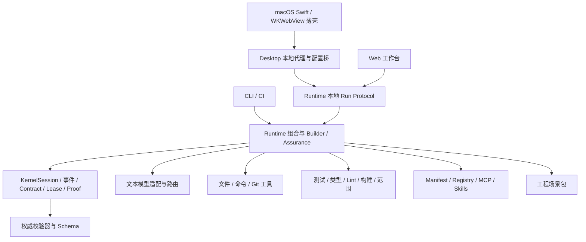

# Keystone 项目、竞品与 UI/UX 差距分析

日期：2026-10-21

审计基线：`1.0.0-rc.1`，Git HEAD `896d3d1`

目标读者：产品负责人、设计、研发与测试

状态：评审草案；不代表已经实现或批准开发

配套文档：[迭代方案](./iteration-plan.md)、[PRD 全量对账与验收](./prd-coverage.md)

## 1. 主要结论

Keystone 已有可运行的工程 Agent 原型：事件账本、Outcome Contract、能力租约、工具执行、确定性验证、Proof、CLI、本地 Web 工作台、macOS 窗口和部分扩展机制。现阶段适合研究和集成运行时，尚不满足 PRD 的完整产品交付标准。

本次重构应同时处理三个层面：

1. **可信运行基础**：补齐证据归属、当前快照、命令副作用、停止、恢复和事件一致性，确保 UI 展示的结果可靠。
2. **完整工作面**：让项目选择、任务切换、文件查看、Diff、设置、输入和证明形成连续流程，替换当前以开发者参数和原始状态为主的界面。
3. **长期扩展能力**：建立端到端多模态、增量项目认知、受治理插件、隔离并行与开放客户端能力，并保留明确的版本和出站边界。

推荐采用“保留内核责任边界、修正实现缺口、模块化重写工作台、按纵向闭环补齐能力”的路线。不能将 UI 重绘、一个配置字段或一个 SDK 类型视为对应功能已完成。

### 1.1 完整范围的解释

PRD 有 **49 个明确编号的功能需求、19 个编号的非功能需求**，还包含生命周期、共享规则、安全、成功度量、首发验收和发布治理要求。数量来自对当前 `需求文档.md` 的逐行提取，不是完成率。

“PRD 全部实现”包含 P0、P1、P2：ACP、隔离并行、子 Agent、Harness Lab、A2A、远程 Workspace、团队共享和签名证明均在其中。它是完整路线目标，不能压缩成一次样式重构。

文件浏览器、完善设置、图片/文档/语音输入是本次明确新增或强化的产品诉求。音视频深度理解、定时任务、浏览器操作、插件创作等应单独制定规格。PRD 当前排除通用办公 Agent、移动端、自动支付/邮件/生产部署、无治理插件市场；改变这些边界需要先修订产品基线。

### 1.2 建议优先级

| 层级 | 要解决的问题 | 优先理由 |
|---|---|---|
| 首要 | 误证明、执行授权和停止竞态 | 直接影响“可交付”及用户硬边界 |
| 首批体验 | 项目/任务导航、工作台结构、文件与 Diff、设置 | 决定用户能否独立完成一个真实任务 |
| 核心补齐 | 实际 Token、恢复续跑、精确失效、项目认知 | 决定复杂任务和长期使用是否稳定 |
| 能力拓展 | 图片/文档/语音、插件中心、IDE、隔离并行 | 消除现代 Harness 的主要体验缺口 |
| 完整路线 | 远程协作、团队共享、签名、跨机器重放 | 实现 PRD P2；依赖前述基础 |

## 2. 事实来源、证据强度与限制

### 2.1 本地来源

- 完整阅读产品基线 `需求文档.md`，核对 `AGENTS.md`、README、ROADMAP、架构概览和相关 ADR。
- 核对 `packages/` 中内核、运行时、工具、验证器、模型、扩展、CLI、桌面壳、场景包及相关测试。
- 在独立临时 Git 仓库、独立数据目录和离线 scripted 模型上运行当前工作台，不使用个人项目历史、真实凭证或云模型。
- 运行基线 `pnpm run verify`：类型检查通过，320 项测试通过。
- 用内存探针核对证明函数的证据归属与未完成检查处理。
- 实际检查 1280×633、900×800、375×812 三种浏览器视口。375px 用于窄窗口适配检查，不意味着新增移动端产品。

### 2.2 外部来源

竞品结论截至 2026-10-21，优先使用官方产品页、官方使用文档和官方开源架构文档。DeepSeek 的公开预览页进行了浏览器观察；完整 DSH 桌面/Web 运行时、Codex 和 Claude Code 未安装或登录实测。因此其功能称为**官方资料确认**，不把营销演示等同于实测任务成功。

官方产品资料能证明公开接口和宣称的能力，不能独立证明成功率、安全性、速度或相对领先。未提供市场份额、性能排名和竞品能力百分比；未做同模型对照实验。

GitHub API 的仓库树查询遇到 403 限流，改用可读取的官方页面；DSH 未固定到具体源码提交。其快速演进部分需要在实施对应协议时再次固定版本。

### 2.3 已发现的文档偏差

PRD 引用的以下三份历史文件在当前工作区不存在：

- `docs/research/2026-10-19-agent-harness-competitive-analysis.md`
- `docs/architecture/2026-10-19-keystone-next-generation-harness-architecture.md`
- `docs/superpowers/specs/2026-10-19-keystone-competitive-product-design.md`

当前有效架构资料为 `docs/architecture/overview.md` 和 `docs/adr/`。这些缺失引用需要在文档整理阶段修正；不能假设旧报告中有已验证结论。

## 3. 当前系统结构与实际能力

### 3.1 结构

这套方向值得保留：客户端不决定完成，场景包不成为内核依赖，模型和插件不自行授予权限。问题集中在部分实现没有把这些边界落实到所有执行路径。

### 3.2 主要能力状态

| 领域 | 已有能力 | 未闭环部分 |
|---|---|---|
| 任务运行 | 任务、Contract、脚本动作循环、修复重试、介入 | 自然语言结果定义较启发式；真实供应商完整闭环未验收 |
| 证明 | 证据等级、条件依赖、循环检查、结构化导出 | 归属/版本/当前快照和完整上游校验不足 |
| 恢复与分支 | 账本重放、检查点、分支记录、比较摘要 | 恢复后继续执行、指定检查点分叉、分支 Workspace 绑定不足 |
| 项目认知 | Git/目录/语言/命令发现、事实与经验原语 | 符号引用、测试关联、嵌套规则、增量索引和依赖失效不足 |
| 文件系统 | 文件读写/搜索/删除与 Git 工具 | 无完整 GUI 文件树、编辑、引用、历史 Diff 和预览流程 |
| 工作台 | 四区高级视图、简洁输入、轨迹、Proof、数据弹窗 | 默认隐藏主要导航，缺任务名、设置中心、文件工作面 |
| 模型 | Chat、Responses、Anthropic、Gemini 适配代码与 mock 测试 | Builder 仍只用文本 Action Envelope；原生 tools、流式、多模态未接通 |
| 设置 | CLI 配置；桌面首次 BYOK 表单；主题与确认开关 | 协议选择、角色路由、热应用、模型目录、预算、数据策略等缺失 |
| 扩展 | Manifest、注册、局部门禁、本地 MCP、磁盘 Skills、参考验证器 | 泛型 SDK 不等于各类型完整可用；安装隔离、执行强制与生态 UI 需补齐 |
| 桌面交付 | 本地代理、进程监督、Swift 窗口、基础菜单 | 缺正式 `.app`、universal、签名、公证及发布验收 |

详细逐项状态及验收映射见 [PRD 全量对账](./prd-coverage.md)。该表中的“部分实现”不是否定已有模块，而是指出用户闭环仍缺少必要环节。

## 4. 影响产品承诺的工程缺口

### 4.1 证明判定没有充分检查证据归属

`evaluateCompletion()` 主要按 `conditionIds`、状态、等级、独立性和可选环境 fingerprint 选择证据，没有在同一流程完整过滤任务、分支、Contract 身份及版本。

对真实 Schema 构造的离线记录进行内存探针，结果如下：

| 输入案例 | 当前返回 | 产品要求 |
|---|---|---|
| 当前任务/分支/Contract 的完整记录 | `proven` | 在其他条件成立时可以通过 |
| 其他任务的记录 | `proven` | 拒绝或有明确受控复用证明 |
| 其他分支的记录 | `proven` | 不能直接支持当前分支 |
| 其他 Contract 的记录 | `proven` | 拒绝 |
| 与当前版本不一致的记录 | `proven` | 必须证明仍适用，不能按状态直接使用 |
| `observation.incomplete` 含未评估目标检查 | `proven` | 必需检查未完成时不得证明通过 |

证据：[evaluate.ts:151–220](../../packages/kernel/src/proof/evaluate.ts#L151-L220)、[evidence Schema](../../packages/schemas/src/schemas/evidence.ts)。

**边界**：这是纯判定函数的已复现输入校验缺口；未在本轮证明外部客户端能够注入这样的记录。不能将其写成已经发生的线上攻击。它仍应作为首批回归测试，因为跨任务、旧版本和插件输出最终都会汇入该判定边界。

### 4.2 证明、完整 Diff 与当前工作区未统一

- 范围检查在已有 `changedPaths` 时可能只使用已知路径，不再核对全部实际 Git 变化。
- 独立命令执行的结果不能可靠报告全部文件副作用。
- 验证后缺少统一的最终工作区重扫和快照封口。
- Proof 导出重建图时传入空 `workspaceFingerprint`，没有与当前 workspace 校验形成一致入口。

证据：[verifiers/scope.ts:40–57](../../packages/verifiers/src/scope.ts#L40-L57)、[runtime:637–734](../../packages/runtime/src/keystone-runtime.ts#L637-L734)、[kernel:810–832](../../packages/kernel/src/kernel.ts#L810-L832)。

因此，“文件工具范围校验通过”不能替代“所有实际副作用都在范围内”。结果页应区分历史验证时状态与当前证明有效性。

### 4.3 租约需要覆盖全部实际执行

工具层已有租约检查，但仍存在：

- 命令约束偏重可执行文件名，实际 argv、环境、工作区和副作用绑定不足。
- 验证命令、模型出站与普通工具没有完全共享同一授权、预算和审计边界。
- `cwd` 和环境过滤不等于操作系统级文件/网络隔离。
- 停止请求与等待中的模型返回存在竞态，`authorize()` 需要再次确认活动状态和撤销状态。

证据：[tools/shell.ts:75–110](../../packages/tools/src/shell.ts#L75-L110)、[verifiers/run.ts:99–127](../../packages/verifiers/src/run.ts#L99-L127)、[kernel:569–631](../../packages/kernel/src/kernel.ts#L569-L631)。

产品上应显示“受应用层范围控制”与“受 OS 隔离”的真实差异。不能仅有 Isolated 标签就宣称具备完整沙箱。

### 4.4 恢复与运行分支还不构成完整连续性

当前恢复能够重放和检查状态，但 CLI 恢复成功后没有完整重启 Builder Loop。分支记录不等于从用户指定检查点创建独立执行路径；隔离工作区也缺少足够的持久关联供恢复使用。

证据：[CLI/task.ts:724–774](../../packages/cli/src/commands/task.ts#L724-L774)、[kernel:915–942](../../packages/kernel/src/kernel.ts#L915-L942)。

验收必须包含真实进程终止、重启、继续动作及验证，而不能只检查状态字符串变回 `executing`。

### 4.5 Token、时间和缓存不能按当前显示视为真实成本

上下文规划存在字符数估计 Token；模型 usage 没有完整进入任务账本，缓存命中与实际节省未闭环。离线工作台显示 `0 token · 0s`，不能据此描述真实模型任务成本。

证据：[planner.ts:75–81](../../packages/runtime/src/context/planner.ts#L75-L81)、[runtime:986–1023](../../packages/runtime/src/keystone-runtime.ts#L986-L1023)。

应分开显示“预估输入”“供应商实际 usage”“尚不可得”和“费用估算”。缓存节省只有实际避免读取/传输时才计入，不能用推测比例替代。

### 4.6 项目认知与长期经验需要事件化、精确失效

已有事实查询、冻结、经验晋升和降级原语，但：

- 初始事实以语言、命令和文件统计为主，缺少符号、依赖和测试映射生产链。
- 部分记录先直接落库，再写相关事件，无法保证完全从权威事件重建。
- 冻结事实和晋升门禁需要在实际写入口再次强制。
- 运行中任务受事实纠正、经验撤销影响后的重建链路不完整。
- 增量更新和精确 Context/Evidence 失效不足。

证据：[seedFacts](../../packages/runtime/src/keystone-runtime.ts#L1231-L1302)、[project/model.ts](../../packages/kernel/src/project/model.ts)、[experience/firewall.ts](../../packages/kernel/src/experience/firewall.ts)。

“有记忆文件”与“越用越稳”之间还需要独立的迁移效果评测。

### 4.7 多 Session 写入与多文件持久化

原子文件写入和账本哈希链已有基础。但内存中的链尾、多 Session 并发追加、项目记录和其他派生文件之间的事务关系，仍需故障注入验证。文件锁不能单独保证读取到最新链尾；一个文件原子替换也不能单独保证多个文件一致。

建议先确定“事件提交是唯一权威提交点”，其余存储能幂等重建，避免为每一种文件组合设计不同恢复规则。

### 4.8 模型配置与凭证边界

桌面配置桥有实际产品问题：

- `/desktop/config/save` 没有贯通协议字段；保存路径默认回到 Chat。
- 连接测试固定调用 `/models`，不能证明 Anthropic/Gemini 原生协议或目标模型生成可用。
- 每次保存配置都会重启运行进程，并改写多个模型角色路由。
- 同 provider/model 的 ID 派生未充分区分 endpoint/protocol。
- 凭证文件采用权限 0600 的明文 JSON，不是 Keychain 或加密存储，与当前架构文件“不存储长期明文凭证”的约束存在偏差。

证据：[config-bridge.ts:98–162](../../packages/desktop/src/config-bridge.ts#L98-L162)、[shell.ts:288–304](../../packages/desktop/src/shell.ts#L288-L304)、[credentials.ts:42–59](../../packages/models/src/credentials.ts#L42-L59)。

这些判断来自源码，未读取真实凭证。建议配置保存和应用分离，先保证新配置只影响后续任务，再做步间安全切换和 macOS Keychain 迁移。

### 4.9 插件注册、检查与实际执行存在断点

默认 `KeystoneRuntime` 使用内建 tools/verifiers 或调用方显式注入对象，尚未根据 active Extension Registry 自动装配模型、工具、验证器、分析器、Workspace 和 Skills。服务器 capabilities 的插件列表是只读展示，不能证明安装后的插件已可被任务调用。

安装与检查流程还有明确边界问题：

- `prepareLocalInstall()` 在展示风险/请求安装确认之前运行动态 conformance；verifier 的 entry loader 会直接 `import()` 未知入口，MCP 探针会启动声明的进程。
- 普通入口仅校验入口文件 digest，不能证明全部传递依赖完整；stdio 分支直接返回 `integrityVerified: true`，这里的含义不是实际哈希校验。
- conformance 中依赖检查主要是范围语法，不是完整依赖解析；冲突主要作为提示。
- MCP 包装器仅检查服务器命令的 `cmd.exec`，输入为 loose object，调用结果没有完整副作用路径；不能证明工具参数对应的资源与出站符合 Manifest。
- registry 有 disable/isolate 等原语，但完整 GUI/CLI 升级、卸载、回退、数据清理与历史任务影响链尚未形成。

证据：[Runtime 默认装配](../../packages/runtime/src/keystone-runtime.ts#L220-L240)、[manager](../../packages/extensions/src/manager.ts)、[conformance](../../packages/extensions/src/conformance.ts)、[CLI install](../../packages/cli/src/commands/extension.ts#L145-L221)、[MCP wrap](../../packages/extensions/src/mcp/wrap.ts)、[registry](../../packages/extensions/src/registry.ts)。

以上为源码确认，未执行未知第三方插件。建议将静态检查、隔离动态探针、用户批准和实际激活分开，避免给现有 `inspect` 或 `integrityVerified` 展示过高的信任含义。

## 5. 当前 UI/UX 实测

### 5.1 初始使用与信息架构

默认 `simple` 模式直接隐藏左右两区。用户可以发起任务，但项目列表、历史任务、Proof、证据与介入区域不在默认视图中；需要发现“高级视图”按钮才能访问主要工作面。

这与 PRD“桌面默认任务工作台”的目标存在张力。ADR-0008 允许简洁模式，而 PRD 要求任务与证明优先。推荐保留简洁体验，但通过面板折叠和渐进披露实现，不再隐藏必需导航和待处理入口。

证据：[workbench.html:655–664](../../packages/runtime/web/workbench.html#L655-L664)。

### 5.2 项目与任务

- 项目列表由已有任务汇总推导，而不是独立项目管理。
- 选择项目只是筛选任务，不保证创建任务输入区同步到该项目。
- 新任务出现后 inventory 不总是刷新，实际演示中项目名暂时退化为重复显示的项目 ID。
- 任务项没有自然语言任务名称，显示状态、ID、证据数量和时间，难以寻找历史任务。
- 项目行是可点击 `div`，没有可聚焦的键盘交互。
- 缺最近项目、置顶、目录迁移、失联、归档、搜索与项目认知同步进度。

证据：[renderProjects/renderTasks:1179–1277](../../packages/runtime/web/workbench.html#L1179-L1277)。

### 5.3 布局与窄窗口

| 视口 | 实际观察 | 影响 |
|---|---|---|
| 1280×633 | 左 288px、中 608px、右 384px；底部表单较高 | 主要任务、证明摘要重复，内容工作面高度被压缩 |
| 900×800 | 左右区维持固定宽度，中间只剩 228px | 阶段标签竖排、文本频繁换行、轨迹难阅读 |
| 375×812 | 文档内容宽度 418px，视口 375px | 标题栏横向溢出，部分按钮不在可见区 |

截图：[1280px](./assets/current-1280.png)、[900px](./assets/current-900.png)、[375px](./assets/current-375.png)。

当前 CSS 已有主题 tokens、焦点样式、状态文本和 reduced-motion 支持，值得复用；不需要把所有样式基础推倒。

### 5.4 中间区、证明与输入

- 中间与右侧重复展示“已完成/可以交付”、文件数、条件数和复现信息。
- Proof Graph 主要是列表和摘要，没有完整的依赖探索与失效影响交互。
- Diff 在大弹窗中显示 unified text，缺文件列表、行导航、二进制状态、内联反馈和历史快照差异。
- 检查点和分支偏展示，缺“校验后恢复”“从这里派生”“比较后受控合并”的闭环入口。
- 底部混合新任务与当前任务控制；“补充约束”只提供目标/写范围/理由，缺完整修订影响预览。
- 等待异步结果时存在多个 UI 状态对象；选择与加载需要整体原子提交和过期响应防护。

证据：[showDiff/showRevise](../../packages/runtime/web/workbench.html#L1917-L1979)、[selectTask](../../packages/runtime/web/workbench.html#L1736-L1765)。

### 5.5 设置、语言与可访问性

- 没有持续可访问的完整设置中心，只有桌面首次模型表单和本地数据弹窗。
- 部分新页面文案未进入中文 catalog，实际初始页混合 `NEW TASK`、英文标签和中文按钮。
- 高级表单的部分 label 未关联输入；项目项键盘不可达。
- 一般模态有焦点处理，但 onboarding 的可取消/只读浏览、焦点和错误恢复应独立验收。
- 长列表分页、视图记忆、重连、草稿保存、状态播报与键盘命令体系需要补齐。

### 5.6 测试覆盖的实际含义

`workbench-page.test.ts` 主要通过文本/正则检查 HTML 结构和关键函数存在。它能保护静态契约，但不能证明按钮正确工作、任务切换不串状态、布局无溢出、焦点可达或桌面菜单行为。

应保留必要静态检查，并新增真实浏览器 Journey、视口截图和 native WKWebView 关键路径验收。

## 6. DeepSeek Harness 的交互与可借鉴能力

### 6.1 产品身份与边界

官方 DeepSeek Harness 是 DeepSeek AI 的开放 Harness，基于 Cordis；公开页提供桌面下载，源码支持 Web、headless、SDK、ACP profile。官方 GitHub 将其描述为快速演进的开发者预览，存在兼容性变化。[cite:1](#cite-1) [cite:2](#cite-2)

搜索中也出现独立社区桌面封装。它们不作为 DeepSeek 官方产品事实依据，避免把社区发行版的功能混入比较。

### 6.2 主要交互链

官方快速开始为：

未选择工作区时输入不可用。模型配置保存后下一次请求生效，不要求重启服务。[cite:3](#cite-3) [cite:4](#cite-4)

相比当前 Keystone，这减少了重复输入路径、配置后中断任务以及误在旧项目发起任务的风险。Keystone 应进一步在输入区明确项目、Workspace、权限和目标任务绑定。

### 6.3 设置与模型管理

DSH 提供模型目录供应商和自定义供应商配置；自定义项包括 provider ID、地址、协议、凭证及模型列表。模型 discovery 使用当前表单草稿参数，保存前不写配置。凭证不回传原值。[cite:4](#cite-4)

值得借鉴：

- 模型目录与手工模型分离。
- 地址/协议/凭证/模型能力明确。
- 连接测试、模型发现与保存是不同动作。
- 模型删除导致保存的默认模型失效时，阻止继续输入并要求选择有效模型。
- 清楚说明配置何时作用于当前或后续会话。

应进一步改善：

- DSH 自定义视觉模型的输入能力仍有配置文件操作，不能认为 UI 已完整支持。
- `/models` 成功不等于目标请求协议兼容。
- 能力声明是用户/目录的声明，不是实际端点能力证明。
- Keystone 需展示测试来源、测试日期与“声明支持/已探测/已验收”三个状态。

### 6.4 文件、输出与开发者详情

官方页面演示文档、表格、HTML、代码、PDF、Markdown 的结果预览与 Diff，并提供执行详情的 Summary/Payload/Result/Schema/Timing 分层查看。[cite:1](#cite-1)

这体现两层工作面：普通任务结果与开发者诊断。Keystone 可借鉴文件打开和分层详情，但保持以完成条件为主的 Proof，而不是把完整工具日志堆到首页。

### 6.5 插件与创作

DSH 的模型、工具、日志、Agent Loop 和 UI 都可由插件组合。插件注册的服务、监听和资源可在卸载时清理；存在 profile/bundle 和配置层覆盖。[cite:5](#cite-5) [cite:6](#cite-6)

官方产品页展示插件列表、实验能力和通过 Creator mode 创作、安装并验证插件的流程。[cite:1](#cite-1)

对 Keystone 的建议：

- 借鉴可发现的插件中心、配置入口、健康状态和自动资源释放。
- 支持 Agent 生成**插件草案**，先进入 Harness Lab。
- 安装、权限、版本、生产激活和卸载影响必须可检查。
- UI 扩展只能消费脱敏投影和提交动作请求。
- Contract、Lease、事件、Evidence、Proof 的权威边界保持固定。

“Everything is a plugin”与 Keystone 的固定信任内核是不同架构选择，不宜直接移植。Keystone 应开放可替换能力，保留不可替代的完成和权限判定。

### 6.6 多模态与后台任务的实际限制

官方资料确认图片输入受模型能力声明限制；手工模型默认文本，DeepSeek 自身 Chat 路由为文本。不能把附件 UI 当作所有模型均可理解图片。[cite:4](#cite-4)

官方页展示语音输入、定时任务、Agent Teams 等实验插件。它们是探索方向的证据，不是稳定质量证明。[cite:1](#cite-1)

Keystone 的优先落点应为截图→文件/代码定位→修改→视觉验收→证据，而非默认启用大量 Agent 或后台周期任务。

## 7. 横向竞争比较

截至 2026-10-21。`官`=官方文档确认；`局部`=Keystone 有代码/局部测试但缺完整交付；`未验`=未验证或资料不足。各产品均按同一维度比较，不把不同产品的“权限”或“完成”语义视为等价。

| 维度 | DeepSeek Harness | Codex App | Claude Code Desktop | Keystone 当前 |
|---|---|---|---|---|
| 项目与会话/任务导航 | 官：工作区选择、Session | 官：多项目、多 thread | 官：Session、项目目录 | 局部：按任务派生项目列表，任务名不足 |
| 模型与设置 | 官：目录/自定义协议、热应用 | 官：模型与 sandbox/MCP 设置 | 官：模型、权限、共享配置 | 局部：CLI 较丰富，桌面表单弱 |
| 文件引用与图片 | 官：能力受模型声明限制 | 官：拖放图片、IDE context | 官：@文件、图片/PDF 等附件 | 未实现图片链路，结构化文件引用局部 |
| 文件/Diff/终端 | 官：结果预览、详情与工具插件 | 官：Diff、hunk 操作、thread terminal | 官：文件编辑、Diff、terminal、可调面板 | 局部：文件工具、文本 Diff 弹窗 |
| 隔离与并行 | 官：可组合 sandbox、子 Agent/实验 teams | 官：Local/Worktree/Cloud | 官：并行 Session、Git 隔离 | 局部：锁与 Isolated；分支续跑不足 |
| 插件/Skills/MCP | 官：插件原生、组合 profile | 官：Skills、MCP 共享配置 | 官：插件浏览、Skills、MCP/connectors | 局部：本地 Manifest/MCP/Skills，无完整插件 UI |
| 长任务与后台 | 官：持久 Session、任务插件 | 官：automations、worktree | 官：background/Cloud/SSH/定时能力 | 局部：检查点/账本，恢复执行不完整 |
| 结果可证 | 有日志与检查；未证实 Keystone 式 Contract/Proof | 有 Diff/检查；未证实同等证明语义 | 有 review/auto-verify；未证实同等证明语义 | 有专门实现，关键判定缺口需修复 |
| 成本与状态可理解性 | 官：执行详情/时间 | 官：任务状态、通知等 | 官：usage、状态、多面板 | 局部：成本未真实对账 |
| 外部客户端/生态 | 官：SDK、ACP profile | 官：App/CLI/IDE 协作 | 官：CLI/IDE/Desktop 多入口 | CLI/CI已有；ACP阻塞，P2未实现 |

来源：[DSH](#cite-1)、[DSH 架构](#cite-5)、[Codex 功能](#cite-7)、[Codex worktree](#cite-8)、[Claude Desktop](#cite-9)。

### 7.1 可复用的市场交互模式

三款产品官方资料共同支持以下设计方向：项目先绑定，输入携带文件上下文，工作区可隔离，任务/会话可切换，Diff 可直接检查，扩展可在 UI 发现和配置。它们可作为体验基线，不构成某种固定视觉风格必须被复制的理由。

### 7.2 Keystone 的差异化需要兑现

| 现有方向 | 价值成立的前提 |
|---|---|
| Outcome Contract | 保留用户目标，不靠关键词拼出泛化检查；修改可追踪 |
| Proof Graph | 归属、快照、独立性、未完成项与失效均真实约束完成 |
| Project World Model | 事实和关系可更新、可纠正、可精确失效 |
| Experience Firewall | 晋升不可绕过，使用效果由独立验证评价 |
| Evidence-Based Autonomy | 只调整已授权边界内的确认频率，有衰减与撤销 |
| 共享 Runtime | 桌面、CLI、IDE、CI 不创建第二套状态和权限语义 |

目前不能宣称领先竞品。领先需要 PRD §13 的同模型、同权限、同预算对照评分卡。

## 8. 多模态与文件系统的产品边界

### 8.1 当前多模态断点

模型消息的 `content` 为字符串；各 provider 明确声明 `streaming=false`、`multimodal=false`。Builder 请求传 `tools: []`，只解析文本 JSON Action Envelope。Responses/Anthropic/Gemini 适配器具有部分原生 tools 映射，不代表 Builder 已使用它们。

证据：[models/types.ts:17–32](../../packages/models/src/types.ts#L17-L32)、[providers.ts:29–75](../../packages/models/src/providers.ts#L29-L75)、[runtime:992–1022](../../packages/runtime/src/keystone-runtime.ts#L992-L1022)。

完整多模态需要输入部件 Schema、内容寻址附件、处理和派生关系、逐模型能力映射、出站预览、恢复重放与验证；不是添加一个回形针按钮。

### 8.2 建议按收益建立闭环

| 输入 | 首个用户价值 | 处理边界 |
|---|---|---|
| 文件/目录/行范围引用 | 精确指向仓库代码 | 不复制整个仓库，不自动扩大读写权限 |
| 图片/截图 | 提交 UI 缺陷或设计参考 | 原件与派生图分别留来源；文本模型明确拒绝或询问转换 |
| 文本、Markdown、日志、CSV/JSON | 给需求与故障上下文 | 预览内容和行范围，大内容按需加载 |
| PDF | 需求/设计资料 | 页范围、文本提取与 OCR 区分，扫描件需处理器 |
| DOCX/XLSX | 工程任务参考附件 | 通过隔离解析器；完整编辑办公文档不并入首版工程核心 |
| 语音 | 口述任务并编辑转写结果 | 首先做转写后提交；原音频是否保存/出站单独控制 |
| 音视频 | 带时间戳的缺陷/交互演示 | 后续做片段、抽帧和音轨；避免默认发送整段 |

PDF/Office/OCR/音视频处理可能需要专用依赖或外部程序。保持核心零运行依赖，将它们封装为受治理、可禁用的处理扩展；若要强制内置，需先确认依赖政策变化。

### 8.3 文件系统应分为三个产品对象

1. **用户仓库**：文件树、搜索、预览、引用、编辑与 Git 状态。
2. **任务 Workspace**：原目录/worktree、检查点、任务变更、比较、恢复和受控合并。
3. **Harness 本地数据**：任务、证据负载、索引、经验、附件、插件数据与保留策略。

三者在 UI 和 API 中分别标识。移除项目记录不删除仓库；清理缓存不删除用户规则；清理工作区不能留下悬空的证明/恢复引用。

## 9. 下一代能力的取舍

以下是产品建议，非当前实现事实，也不宣称竞品均不存在。

| 建议 | 优先级 | 可验证的产品价值 | 进入条件 |
|---|---|---|---|
| 每步骤的数据出站预览 | 核心 | 用户知道将发送什么、为何发送、到哪里 | 实际 route/fallback 与 Context Plan 对齐 |
| 附件和上下文来源图 | 核心 | 派生摘要/OCR 保留来源，删除可追踪影响 | 来源与引用索引完备 |
| 反事实验证 | P1 | 缺陷基线失败、修复后通过，证明测试有判别力 | 独立基线 Workspace 和受保护验证 |
| 可恢复的执行服务与任务队列 | P1 | 窗口关闭/模型暂不可用后继续或可靠暂停 | 明确前后台策略、启动与持久化边界 |
| 旁路问答与草稿修订 | P1 | 查看问题不改变运行目标；修改须生成新版本 | 输入意图、任务版本、事件化消息 |
| 浏览器视觉验收扩展 | P1 | UI 修复附 DOM、截图和操作路径证据 | 隔离浏览器与独立验证器 |
| 按可证明子任务委派 | P1 | 并行减少时间且不互相覆盖文件 | 独立 Workspace、预算、租约和父任务复核 |
| 插件草案创作与 Harness Lab | P1 | 通过隔离测试后可安装、回退 | 受约束 SDK、无默认生产激活 |
| 定时任务 | 探索 | 有清楚范围的周期检查 | 幂等、无人时介入策略、配额和错过执行策略 |
| 本地语义检索/语言分析 | P1 | 大仓库定位更准确、失效更精确 | 明确离线模型/解析器来源和资源占用 |
| 跨模型安全路由 | P1 | 能力不兼容时可预测失败或选择替代 | 每模态测试记录、出站策略与费用上限 |
| 团队规则与证明共享 | P2 | 分享可验证工件，不共享未经确认推断 | 身份/签名/冲突与本地采信策略 |
| A2A 和远程 Workspace | P2 | 委派远端工作并保留来源与验收 | 可协商身份、租约、回执、外部证据验证 |

不推荐以 Agent 数量、插件数量或聊天动效作为下一代能力指标。应关注完成条件保真、逃逸缺陷、恢复率、实际成本和人工介入次数。

## 10. 方案选择

| 方案 | 内容 | 优点 | 成本与风险 | 结论 |
|---|---|---|---|---|
| A. 现有单文件局部美化 | 调 CSS、增加若干弹窗 | 首次视觉改善快 | 2552 行单文件与能力缺口继续累积；无法完成需求 | 可用于临时修正，不适合作为主路线 |
| B. 保留运行时，模块化工作台与能力闭环 | 原生 ESM/DOM 分层、统一客户端、按域补齐 API | 保留零生产运行依赖和 native 薄壳；边界清楚、迁移可控 | 自建有限组件需规范与浏览器验收；底层问题仍需认真修复 | **推荐** |
| C. 引入 React 等 UI 框架与新桌面平台 | 组件库/编辑器/复杂面板体系 | 复杂界面生态成熟 | 改变依赖与构建政策；新供应链、native 和迁移成本 | UI 复杂度实证超过方案 B 后再决策 |

保留现有 TS/native type stripping；不为本轮直接引入 React、Electron、全功能 IDE 或数据库。未来确需 CodeMirror/Monaco、AST parser、SQLite 等，先基于实际规模和 UX 收益提出单独 ADR 和成本比较。

## 11. 评审决策

迭代方案已为以下问题提供推荐值，但它们仍需产品确认：

1. 是否保持“工程 Harness”为核心，完整 P0/P1/P2 是路线目标，首个批次先交付可信运行与完整本地工作面。
2. 是否采用方案 B，保留 macOS WKWebView 和零核心运行依赖。
3. 多模态首批是否为图片、文本附件及文件引用；PDF/Office/OCR、语音和视频按隔离扩展逐步加入。
4. 视觉是否采用低饱和中性色、蓝色主动作、系统字体、浅深主题与面板式工作台。
5. 云模型 fallback、非 Git 项目、插件创作和定时任务是否按推荐边界实施。
6. 正式 macOS 安装包是否必须与首次 UI 迭代同步交付。

具体推荐、规格、开发落点、验收标准和里程碑见 [迭代方案](./iteration-plan.md)。确认这份草案前，原 PRD 与既有 ADR 仍是产品和架构基线。

## 12. 验证结果与仍未验证项

| 检查 | 结果 | 证明边界 |
|---|---|---|
| `pnpm run verify` | TypeScript 通过；320 测试通过 | 现有测试覆盖；不证明 PRD 全量完成 |
| 离线工作台真实交互 | 创建受限写任务、切换视图、查看终态通过 | scripted 模型、临时 Git 仓库，无真实 provider |
| 三视口检查 | 复现 900px 主区挤压、375px 标题栏溢出 | Chromium 浏览器，不是原生 WKWebView 实测 |
| `node /tmp/keystone-proof-audit-probe.ts` | 六组 Schema 合法输入；五组不该直接通过的记录均被判 `proven` | 纯函数层复现，不是外部注入攻击证明 |
| DSH 官方页 | 页面内容和交互演示可读取 | 未安装完整 DSH 运行时 |
| 真实模型/多模态/远程/分发 | 未验证 | 需要后续专项验收 |

尚缺真实供应商兼容、模型实际成本、原生桌面 UX、大仓库增量性能、真实崩溃续跑、全部插件类别、同模型竞品对照以及签名公证的验收证据。

## 13. 外部来源

**[cite:1] DeepSeek Harness 官方产品页**，2026-10-21 读取。公开预览、桌面下载、插件/文件/定时/开发者演示。

https://www.deepseek.com/en/harness/

**[cite:2] DeepSeek AI 官方 Harness 仓库 README**，2026-10-21 读取。身份、预览状态、源码启动方式。

https://github.com/deepseek-ai/deepseek-harness

**[cite:3] DSH Web UI 快速开始**，2026-10-21 读取。工作区、模型、任务启动流程。

https://deepseek-harness.github.io/deepseek-harness/en/guide/quickstart

**[cite:4] DSH 模型配置指南**，2026-10-21 读取。热应用、自定义协议、凭证、模型目录、图片能力限制。

https://deepseek-harness.github.io/deepseek-harness/en/guide/providers

**[cite:5] DSH 官方架构**，2026-10-21 读取。Cordis、profile/bundle、desktop、session、能力扩展点。

https://github.com/deepseek-ai/deepseek-harness/blob/master/docs/architecture.md

**[cite:6] DSH 插件开发教程**，2026-10-21 读取。注册、依赖和卸载清理。

https://deepseek-harness.github.io/deepseek-harness/en/develop/basic/

**[cite:7] OpenAI Codex App features**，2026-10-21 读取。多项目、Skills、MCP、Diff、终端、图片、通知。

https://developers.openai.com/codex/app/features/

**[cite:8] OpenAI Codex Worktrees**，2026-10-21 读取。隔离、分支、同步和清理。

https://developers.openai.com/codex/app/worktrees/

**[cite:9] Claude Code Desktop application**，2026-10-21 读取。Session、权限、附件、文件/Diff/终端、浏览器、插件、多面板。

https://code.claude.com/docs/en/desktop

**[cite:10] MCP 当前 transport 规范**，读取时最新为 2026-07-28；与当前 Keystone 的 initialize-based 实现有兼容差异。

https://modelcontextprotocol.io/specification/2026-07-28/basic/transports

**[cite:11] ACP Session Setup**，2026-10-21 读取。初始化、Session、恢复、客户端能力与 MCP 传输。

https://agentclientprotocol.com/protocol/session-setup

这些来源仅用于对应范围的事实确认。MCP 与 ACP 的具体实现需固定目标协议版本并运行互通测试，不能直接跟随 `latest` 改写兼容性。
