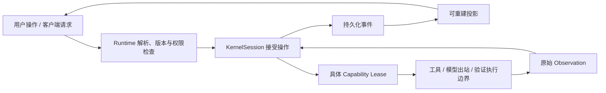
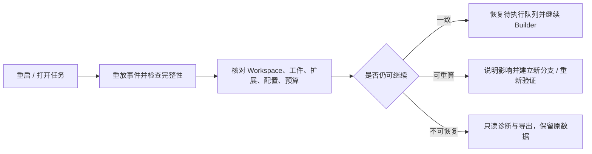

# Keystone UI/UX 与完整 Harness 能力迭代方案

日期：2026-10-21

状态：推荐技术、视觉与分期范围已确认；M0–M3 本地开发与验收完成，外部验证边界见 [首批验收](./acceptance.md)；M4–M8 保持开放

基线：PRD v1.0、仓库 `1.0.0-rc.1`、[差距分析](./analysis.md)

验收契约：[PRD 全量对账](./prd-coverage.md)

## 1. 目标、范围与完成定义

目标是把当前工程运行时原型升级为完整的本地工程 Agent 工作台：用户能选择项目、提交含文件与多模态参考的任务、理解目标与范围、持续执行、恢复、审阅代码、检查证据、管理设置和扩展。

完整路线覆盖原 PRD 的 P0、P1、P2，以及本次明确提出的文件系统、项目选择、设置和多模态体验。首次开发批次建议集中 M0–M3，随后完成 M4–M8；批次完成不宣称整个 PRD 完成。

完成以三层验收为准：

1. **功能契约**：每个 PRD ID 和新增需求都有实现落点、行为状态与验收脚本。
2. **可信契约**：Contract、Lease、Provenance、Evidence、Proof、恢复和经验不变量通过拒绝路径及故障注入测试。
3. **产品契约**：真实浏览器/WKWebView 关键旅程、可访问性、实际供应商兼容与发布质量获得证据。

本方案中的默认值、尺寸和人日范围均为设计建议，非当前实现事实或交付承诺。

## 2. 推荐架构与备选

### 2.1 采用方案 B：固定信任内核、模块化工作台、纵向能力闭环

- 保留 TypeScript monorepo、Node native type stripping 和 `node:test`。
- 保留 macOS Swift/WKWebView 薄壳与共享 Runtime。
- Web 使用原生 ES modules、DOM 和 CSS，建立有限、明确的组件和视图边界。
- 服务端增加按产品域组织的读投影与操作请求；全部权威任务写入仍通过 `KernelSession`。
- 文档解析、OCR、语音、视觉验收等重能力放入可独立禁用的扩展。
- 如确需第三方编辑器、语言解析器或数据库，依据真实规模另做依赖决策。

不直接引入 React/Electron，因为它们会改变当前零生产运行依赖与无转译约束。未来采用框架可以重用协议和产品域设计，但应先取得依赖与构建政策变更确认。

### 2.2 模块落点

以下是拟新增或拆分的路径，当前并不存在全部这些模块：

| 区域 | 建议落点 | 责任 |
|---|---|---|
| 页面入口 | `packages/runtime/web/workbench.html` | 页面骨架、启动和静态语义 |
| 主题与布局 | `packages/runtime/web/styles/` | tokens、主题、布局、控件与状态 |
| 客户端通信 | `packages/runtime/web/client/` | 协议协商、请求、订阅、错误与取消 |
| 展示状态 | `packages/runtime/web/state/` | 项目/任务选择、草稿、加载版本；无权威业务状态 |
| 界面组件 | `packages/runtime/web/components/` | 面板、列表、表单、菜单、树、Diff、附件 |
| 产品视图 | `packages/runtime/web/views/` | 工作台、项目、文件、设置、插件、认知、Lab |
| API 路由 | `packages/runtime/src/http/` | 从 `server.ts` 按域拆分，限制公共接口 |
| 项目管理 | `packages/runtime/src/projects/` | 项目目录、Workspace、同步与读投影 |
| 配置应用 | `packages/runtime/src/config/` | 配置修订、有效配置、角色路由与安全应用 |
| 附件管道 | `packages/runtime/src/attachments/` | 导入、工件、派生、按模态规划 |
| 内核修正 | 既有 `packages/kernel` / `schemas` | 证据准入、授权、事件与恢复语义 |
| 场景认知 | `packages/pack-engineering` | 规则作用域、语言/测试关联、增量生产 |
| 扩展宿主 | `packages/extensions` | 一致性、权限约束、隔离、版本与生命周期 |
| 原生桥 | `packages/desktop` | Keychain、文件面板、菜单、通知、窗口与分发 |
| 文案 | `packages/i18n` | 所有可见文案，不改变机器格式 |

目录拆分以实际职责为准，不为每个按钮建立一个包。UI 只依赖版本化投影，不能直接读取本地事件文件或凭证。

### 2.3 权威与展示状态



页面可以立即显示“请求已提交”，只有内核事件才能显示“已暂停”“目标已修订”“权限已改变”“已证明”。界面失联时保留已知状态并标记陈旧，不猜测成功。

## 3. 信息架构与视觉方向

### 3.1 保持 PRD 的区域职责

```text
┌ 当前项目 ▾  Workspace / 分支   运行状态   待处理   搜索   设置 ┐
│ 项目 / 任务 / 文件 │ 任务标题 · 目标摘要 · 当前阶段 │ 证明 / 处理 │
│ 最近与置顶项目    │ 概览 | 轨迹 | 文件与变更 | 比较 │ 条件进度    │
│ 按状态组织的任务  │                              │ 当前有效性  │
│ 项目认知与经验    │ 当前工作内容与可展开关键轨迹    │ 风险与来源  │
│ 扩展 / Harness Lab│                              │ 按需详情    │
├──────────────────┴──────────────────────────────┴─────────────┤
│ [当前任务补充 ▾] 输入内容   附件 / @文件 / 约束 / 提交          │
│ Workspace 状态 · 模型与路由 · 本地/云端 · 已用/剩余预算         │
└──────────────────────────────────────────────────────────────┘
```

左侧对象导航、中间执行工作面、右侧证明和介入、底部输入与资源状态保持职责。设置/插件/文件是工作台内可切换视图，不创建另一个任务权威。

### 3.2 视觉规范建议

| 项目 | 建议 |
|---|---|
| 风格 | 低饱和专业工作台，边界清楚，减少重复卡片和装饰 |
| 主色 | 蓝色用于主动作/选择，成功/警告/失败各自语义色 |
| 字体 | 系统中文/无衬线字体；代码与路径使用系统等宽字体 |
| 默认主题 | 跟随系统；可选浅色、深色 |
| 密度 | 舒适、紧凑两档；正文建议 14px，关键目标 16px |
| 层级 | 背景、面板、浮层三层；关键状态不靠颜色单独表达 |
| 动效 | 主要用于展开与状态变化，约 150–200ms，尊重 reduced motion |
| 图标 | 一套本地随包图标与文字标签；图标按钮具可访问名称 |
| 中英文 | 全部交互文案进入 catalog；路径、状态协议字段和 Proof bytes 不翻译 |
| 状态文本 | “执行中”“需要处理”“已证明”“当前证明失效”；明确下一步 |

蓝色主动作和成功绿色分开，避免将权限按钮或“模型已经回复”表达为任务成功。实际色值需对两种主题测对比度，不能以设计库建议代替验收。

### 3.3 响应式与面板

- ≥1280px：三栏；左侧约 240–280px，右侧约 320–360px，中间工作面优先。
- 1000–1279px：右侧默认收为 inspector；待处理数量和证明摘要持续可见。
- <1000px：左侧导航与右侧详情成为抽屉，中间保留任务与主要操作。
- 极窄窗口：顶部按优先级折叠，内容不得横向溢出；保持所有主操作可达。
- 支持鼠标/键盘调整分栏，按项目保存宽度；限制中间最小宽度。
- 用户手动折叠面板不影响权限、证明和状态；出现介入仅提示，不强制跳走正在查看的内容。

“专注视图”保留导航入口、任务切换和证明摘要，通过折叠细节减少噪音，不再完全隐藏左右职责。

### 3.4 全局导航与快捷键

建议提供 `Cmd+K` 命令面板、`Cmd+O` 项目选择、`Cmd+P` 文件搜索、`Cmd+,` 设置、`Cmd+Enter` 提交、`Esc` 关闭浮层。快捷键先避免和原生编辑/缩放冲突，允许用户重映射。

任务、文件、设置和插件各有搜索范围；全局搜索结果显示所属项目、快照、新鲜度和对象类型。先用现有本地索引和确定性搜索，语义检索作为可选扩展。

## 4. 项目选择与 Workspace 管理

### 4.1 首次接入

1. 首屏显示最近项目、添加项目和只读浏览入口。
2. 通过原生 `NSOpenPanel` 选择目录；直接 Web 模式提供路径输入与明确校验。
3. 校验 Git 根目录、可读取性、路径规范化、重复注册和指向关系。
4. 展示项目名、根目录、当前分支、已有 dirty/untracked 修改、支持矩阵。
5. 基础扫描完成即可发起任务；后续认知同步显示进度、来源和异常。
6. 无法识别的命令标为未识别，并引导用户确认入口。

P0 保持 Git 项目要求。未来可以通过 Workspace 适配器支持非 Git 目录，但不能将其伪装成可分支、可重放的 Git Workspace。

### 4.2 项目对象与行为

项目列表独立于任务列表。支持添加、最近、置顶、显示名、分组、归档、失联恢复和移除记录。移除项目先展示历史任务/证据/扩展影响；不删除代码。

项目身份需区分“仓库身份”和“Workspace 实例”。同仓库不同 worktree 不混合工作目录、临时事实或当前证据；移动目录时保留仓库身份并重新确认映射。

切换项目：

- 同步标题栏、任务列表、文件树和新任务草稿的项目绑定。
- 当前任务不会迁移到另一个项目。
- 未提交输入按 project/task 保存，返回后恢复。
- 异步旧响应被丢弃；加载结果整体提交到同一个选择版本。

### 4.3 并发与分支

同 Workspace 默认一个写任务；只读任务绑定读取快照。第二个写任务提供排队或新建 worktree，而不是强制抢占锁。

运行分支记录必须绑定父检查点、Contract、预算、Workspace、动作和证据。选择“从这里派生”时复制指定检查点之前的事件前缀，后续拥有独立执行记录。

合并入口展示冲突、目标目录既有修改、范围和需要重跑的检查。合并后产生新的快照和证据，不能继承另一分支的 `proven` 标签。

## 5. 文件工作面与本地数据系统

### 5.1 文件树、搜索与预览

首批支持：

- 按项目/Workspace 加载目录，延迟展开与分页，不一次返回整个仓库。
- Git modified/new/deleted/renamed 状态、图标、路径与过滤。
- 文件名快速搜索、内容搜索、行号跳转、目录范围搜索。
- 文本/代码/Markdown/图片基础预览；二进制显示类型、大小和打开方式。
- `@文件`、目录和行范围引用；清楚标识引用的是当前快照还是历史工件。
- 文件标签页和最近打开状态；失败时保留路径与原因。

读取范围、symlink、大小写、文件编码、超大文件、分页截断和失联路径均需在 API 端检查。目录名称来自不可信工作区内容，渲染不得直接插入 HTML。

### 5.2 手动编辑

首版用轻量文本编辑与预览，不承诺完整 IDE。

保存请求携带预期内容哈希。文件已被 Agent/外部编辑改变时，显示差异并要求重新载入或明确解决冲突，避免覆盖。

人类编辑具有独立来源，不混入 Agent 的变更归属；保存经受控写边界记录，触发相关快照、Context 和 Evidence 重评。是否占用活动写任务的文件需先协调。

新建、重命名、删除与回退均需要合法资源范围和可恢复方式。可逆操作保留内容工件或补偿记录；不能把“撤销”实现为整个仓库 reset。

### 5.3 Diff 与反馈

- 展示当前任务实际变更文件列表。
- 支持统一/双栏 Diff、行导航、搜索、变更统计和二进制说明。
- 区分任务变更、用户原有 dirty 修改和后续外部修改。
- 旧任务 Diff 来自当时的基线/结果工件，当前工作区 Diff 是另一个明确视图。
- 行评论可集中提交为修订草案，不直接修改完成条件。
- Stage、commit、rollback/合并可在能力完整后加入，调用现有受限 Git 边界。

### 5.4 终端与命令

首批以命令面板提供独立执行、输出、退出码、环境摘要和复现命令。模型执行保留独立动作语义，不依赖隐藏的持久 Shell 状态。

后续通过受治理终端扩展提供人类 PTY；其命令与环境需标识来源、Workspace 和副作用。人类终端输出不会自动获得 E2/E3 证据等级。

### 5.5 本地数据设置

本地数据页按项目、任务、附件、证据负载、索引、经验、插件数据和 worktree 展示占用与依赖。

提供保留策略、配额提醒、清理预览、只读导出和迁移预览。建议默认：

- 冻结规则、活动任务、未完成恢复点与仍被有效 Proof 引用的工件不自动删除。
- 可重建索引/缓存可清理，清理后显示重建状态。
- 清理原始证据前说明哪些证明只能保留摘要、哪些重放能力会失去。
- 删除生成 tombstone/撤销与派生重评记录，而不是仅移除文件。
- 迁移采用复制、校验、切换引用，再保留原目录供回退。

## 6. 设置中心

### 6.1 设置作用域

设置分为全局、项目、任务、扩展四种作用域。每个字段展示来源与有效值；任务和扩展配置只能在用户硬边界内收窄。

展示偏好可在本地持久化；预算、权限、数据出站、模型应用和影响任务的策略需要受控配置修订。仓库设置可以增加约束，不能自行增加 Allow。

### 6.2 页面与字段

| 页面 | 主要设置 | 行为与默认建议 |
|---|---|---|
| 通用与外观 | 语言、主题、密度、字号、面板、快捷键 | 语言默认系统可解析语言，否则中文；主题跟随系统 |
| 模型与路由 | provider、protocol、endpoint、模型目录、能力、role、fallback | 区分文本/图片/原生 tools；本地到云端不自动切换 |
| 项目与 Workspace | 默认工作区方式、识别命令、忽略范围、同步状态 | 单写默认；未知命令待用户确认 |
| 执行与权限 | 文件/命令/网络/凭证范围、确认策略、预算、重试 | 默认拒绝；可查看边界、决定历史和撤销 |
| 上下文与认知 | 每步预算、附件纳入、索引状态、事实与经验策略 | 候选经验不入执行上下文；冻结规则受保护 |
| 数据与存储 | 数据根、配额、保留、清理、导出、迁移 | 活动任务与证明引用工件默认保留 |
| 隐私与出站 | 本地/云端策略、允许提供方、附件发送、诊断导出 | 显示实际目标；不默默出站或自动上传遥测 |
| 通知与后台 | 完成/需要处理通知、关闭窗口、休眠行为 | 关闭窗口默认安全暂停；后台继续需用户启用 |
| 插件与实验 | 安装、权限、配置、版本、健康、回退、Lab | 实验能力单独开关；升级不继承新增权限 |

### 6.3 模型配置闭环

每个模型条目使用稳定 ID，与 display name 分离。编辑地址或名称不覆盖另一条同名模型。

表单包含：

- 本地/云端、provider、protocol、base URL、credential handle。
- 模型 ID/名称、上下文上限、声明输入模态、原生 tools/JSON/streaming 能力。
- planner/builder/summarizer 等角色路由和有序 fallback。
- 探测状态、时间、版本与错误；实际费用来源和未知费用状态。

四个独立操作：

1. **发现模型**：查询支持目录的端点，失败允许手工输入。
2. **连接检查**：按协议检查连通/鉴权，不称为模型可用验收。
3. **生成检查**：明确用户触发的小请求，记录目标模型和实际 usage。
4. **保存并应用**：原子配置修订，显示对活动/后续任务的影响。

初版保存只影响后续任务。活动任务固定其配置版本，随后在安全步骤边界提供明确切换；不通过重启所有任务应用配置。

若路由能力不支持附件/工具调用，发送前明确阻止或给出用户可选的降级路径。降级记录与新出站目标必须进入 Context Plan 和任务轨迹。

### 6.4 凭证

macOS 默认使用 Keychain 或独立 credential broker；CLI 与桌面共享 handle，不向模型、页面配置读取、日志或 Proof 返回秘密。

当前权限文件存储需提供迁移：发现旧记录只展示 handle，写入受保护存储后验证引用，再经明确操作处理旧明文记录。不能以改配置路径而遗留未声明的副本。

云端代理地址、自定义 endpoint 和 fallback 需要重新检查目标 host 与出站政策。支持多个本地模型，不将无密钥等同于可信或无需能力检查。

## 7. 输入与多模态

### 7.1 统一输入器

输入器明确当前操作：新任务、补充信息、增加约束、修订目标、旁路询问。运行中内容进入内核消息/修订队列，在安全边界处理。

附件方式：按钮、拖放、粘贴截图、原生选择、`@文件/目录/行范围`。每项显示名称、类型、来源、页/行/时间范围、大小、处理状态、是否会出站、移除入口。

只增加参考资料不自动修改目标；约束或目标变化先生成修订草案和影响列表，用户确认后创建新 Contract 版本。

### 7.2 首批范围与拟定上限

首批建议支持 PNG/JPEG/WebP 截图，UTF-8 文本、Markdown、日志、CSV/JSON 与仓库引用。建议上限：一次最多 10 个外部附件，图片单文件 20 MiB，文本单文件 10 MiB；大内容按需分块，不全部塞进模型上下文。

这些是初版资源保护建议，需在真实模型/设备样本上校验。超限提供明确原因与裁剪/分块入口，不静默截断。

PDF 首先支持文本型页面提取及页范围；扫描件 OCR、DOCX/XLSX 和语音通过解析扩展加入。视频需要片段、抽帧和时间戳，放到后续能力批次。

### 7.3 端到端管道


导入、解析和发送是不同状态。取消附件要取消对应处理；任务提交前未完成的附件可以等待或明确跳过。处理失败不丢失草稿。

### 7.4 Schema 与 provider 映射

建议使用有类型的内容部件：text、image、file_reference；音视频部件在对应功能成熟后加入。旧字符串消息可无损规范化为 text part。

附加元数据包含工件 hash、MIME、字节数、来源、派生链、页/行/时间范围、处理器版本和数据分类。协议传引用，不把大二进制直接写进事件账本。

各 provider 单独实现映射及兼容测试。声明和实测分离，Unsupported modality 必须在发送前产生可见错误。

### 7.5 语音与视频

语音先做“按住录音→本地/明确出站转写→编辑文本→提交”；不让识别结果自动触发任务。权限拒绝、录音中断、重试、取消、原音保留策略和转写来源均需覆盖。

视频后续支持时间范围、关键帧和音轨引用。若模型不支持原视频，可由扩展生成带时间戳的派生上下文，展示损失，保留原件来源；不能称为完整原视频理解。

## 8. 目标定义、轨迹与结果审阅

### 8.1 Contract

自然语言任务产生结构化草案，但用户结果不能被关键词正则截断或改写。编译器结合真实规则、测试入口和受影响代码提出候选，再由内核校验字段、约束和风险。

用户界面展示目标、范围、不变量、完成条件、最低证据/独立性、预算、未知项、介入/退出条件。

修订有三步：编辑草案→查看受影响动作/租约/证据/分支/经验→创建新版本。仅改显示名不触发 Contract 修订；更改完成条件一定触发。

### 8.2 轨迹

默认显示当前步骤、关键动作、文件、命令摘要、检查点、验证状态和原因。详细分层为摘要、参数、输出、Schema、环境和时间；不展示思维链。

增加筛选、搜索、按阶段聚合、加载历史、跳到最新和保留用户滚动位置。大输出读取内容寻址负载，不在列表中全量渲染。

### 8.3 证明面板

右侧优先展示：

1. 必需条件进度及当前证明有效性。
2. 未完成、阻塞、失败或失效的原因。
3. 需要用户的事项。
4. 关键风险和可执行下一步。

点击一个条件逐层进入证据、生产者、快照、依赖和原始 Observation。图形视图作为可切换的依赖探索；列表与文字同样完整可用。

“已证明”必须使用服务器当前判定；若工作区变化，历史状态保留而当前 proof 显示有效/部分失效/失效。导出与页面使用相同输入和准入规则。

### 8.4 独立验证与修复

- 按条件识别真实检查入口；未知时阻塞，不能默认猜测成功。
- 受影响检查选择与最终检查分开，最终覆盖 Contract 必需项。
- 使用内容变化、失败条件和验证结果判断进展，不能只数文件名变化。
- 保护测试入口/断言/检查规则，防止通过弱化测试制造成功。
- 对适用修复增加基线失败→候选通过与变异/反事实验证。
- E3 需要真实独立 Workspace/复核流程；E4 需要可验证外部来源，不能用标签升级等级。

## 9. 可信执行、恢复与项目认知

### 9.1 证据准入与证明

首批统一检查：

- task、branch、Contract 身份与修订适用性。
- 完成条件对应生产者/版本和规定独立性。
- 来源、工件 hash、当前及验证快照。
- 未完成项、失效上游、循环和冲突。
- 完整实际 Diff、原有 dirty 修改归属和最终范围。

旧证据复用必须有明确适用性判断和事件，不能把旧版本 `valid` 当作当前版本通过。隔离验证需要证明源快照/补丁等价，不直接要求不同工作目录具有相同任意 fingerprint。

### 9.2 全部执行共享边界

工具、模型出站、验证器和扩展实际执行绑定主体、能力、资源、参数、环境、预算、有效期和撤销状态。

停止后在下一次副作用前再次检查。等待中的模型返回不能绕过停止/暂停；队列中的操作使用幂等 ID。

进程隔离、工作区隔离与 OS sandbox 分别记录。对任意命令不能只靠可执行文件白名单宣称限制了网络或文件写入；建立被测的 Workspace/sandbox provider，无法保证的限制明确拒绝或声明。

### 9.3 恢复

恢复链路为：



检查点必须持久化当前 Workspace 位置、基线、Contract/扩展/config 版本、预算和待执行状态。真实 SIGTERM/SIGKILL 在动作前后、事件提交、检查点写入等窗口进行故障注入。

### 9.4 增量项目认知

先完善确定性基础：目录/包/入口/命令/规则作用域、文件依赖及测试关联。TS/JS 可以使用版本化语言分析扩展；不得让内核硬依赖场景 parser。

以完整内容哈希和关系索引触发增量生产；文件监听是变化提示，不是事实真相。启动/恢复核对漏事件，必要时有限重扫。

事实保留有效时间和观察时间、来源、快照、信任和失效条件。纠正/冻结/删除经事件记录，高优先级用户规则不被自动 upsert 覆盖。

### 9.5 Context 与学习

Context 选择纳入真实事实、经验、相关文件和附件，同时记录排除原因、预算、完整来源与失效依据。

实际 usage 累计入账；缓存记录实际避免的操作。压缩只保留可追踪的派生内容，不能把不可信输入升级为规则。

经验晋升由内核事件和门禁决定；使用前核对冲突、适用版本和负向记录。撤销后重新构建引用它的活动 Context。正向/负向迁移与遗忘通过独立任务集评价。

## 10. 插件系统

### 10.1 插件中心

导航为“已安装 / 本地添加 / 权限与健康 / 更新与回退 / Harness Lab”。每项展示：

- 名称、版本、发布者声明、安装源、内容 hash 与兼容范围。
- 类型、能力、资源、网络、凭证、数据出站。
- 已声明、已验证、用户已允许、当前实际启用的差异。
- conformance 结果、健康、失败原因、影响任务和数据大小。
- 启用、禁用、配置、升级预览、回退、卸载影响预览。

发布者名称只是声明；来源/完整性检查与真实身份验证不能混淆。

### 10.2 扩展类别与接口

| 类别 | 需形成的完整接口 | 主要门禁 |
|---|---|---|
| Model | 模态、流式、tools、usage、取消、transport | 声明与真实能力一致，出站可检查 |
| Tool | 输入/输出 Schema、执行、副作用、幂等 | 全参租约、结果来源、超时和取消 |
| Verifier | 条件、等级、独立性、环境、结果 | 证据由内核记录，禁止自行完成 |
| Project Analyzer | 输入快照、事实/关系提案、增量失效 | 不直接写 Project Fact，保留来源 |
| Workspace | 创建/快照/恢复/隔离/比较/清理 | 资源范围、补偿、完整性与恢复 |
| Protocol | 协商、投影、请求转发、兼容 | 权威仍在内核，降级可见 |
| Skill | metadata/body/resource 渐进加载 | 内容不可信，脚本单独授权 |
| UI 扩展 | 声明式面板/操作与受限消息桥 | 无凭证、无任意 Runtime/文件写访问 |

新增 UI 扩展类别需 ADR/Schema 设计。先提供有限声明式贡献，确需可执行视图时隔离运行和严格 bridge；不允许插件顶层脚本进入拥有授权信息的主文档。

### 10.3 安装、升级与卸载

1. 读取 Manifest/内容并进行静态校验，形成风险预览。
2. 未授权前不在宿主进程执行未知入口。
3. 动态探针在独立临时 Workspace、受限环境和执行边界运行。
4. 按 schema、依赖、能力、恢复、违规、超时和大输出进行 conformance。
5. 用户确认具体版本和能力后注册/激活。
6. 升级比较新增权限、内容与兼容变化，活动任务固定旧版本或安全暂停。
7. 禁用/卸载清理服务资源，保留解释旧事件/证据所需的生产者元数据与引用。

动态行为测试不可能证明任意第三方代码永远安全；因此安装检查不能代替执行期间的强制边界。

### 10.4 MCP

当前本地 stdio 能力应先完善实际逐调用授权、资源/出站声明和真实 Runtime 注册。

后续增加 Streamable HTTP、认证/凭证 broker、resources/prompts、取消、分页和健康检查。固定目标协议版本和兼容窗口，不能直接用旧 initialize 握手代表所有最新 MCP 语义。

截至研究时 MCP 最新文档为 2026-07-28，其 request metadata/消息方向/兼容机制与旧版有差异。实施前需要专门的版本矩阵和跨版本 conformance。

### 10.5 Skills

在 UI 查看来源、作用域、摘要、正文、资源、变更和使用记录；支持全局/项目启用与渐进加载。安装或选中 Skill 不执行脚本。

模型请求加载 body/resource 时，记录来源与 Context Plan；脚本运行产生独立 Action Proposal 和 Lease。Skill 文本不能覆盖用户目标、权限或完成条件。

### 10.6 Harness Lab 与插件创作

Lab 使用独立数据根和临时 Workspace，比较扩展前后的完成率、成本、恢复和安全行为，生成可导出的兼容报告。

插件创作流程：描述需求→生成草案→静态检查→隔离测试→展示能力与风险→明确批准安装。Agent 不能自动将生成的插件挂入正式任务。

先维护本地和参考扩展目录；公共市场在签名/撤销/版本/供应链治理成熟后进入路线，符合 PRD 当前边界。

## 11. IDE、CI、远程与团队

### 11.1 ACP 与 IDE

当前 ADR-0011 阻止直接发布有损 ACP adapter。本轮不把协议名映射成聊天/权限弹窗就宣布兼容。

建议先形成新的映射 ADR，评估“标准 ACP 展示 + 请求转发 + 显式 Keystone 能力命名空间/独立证明工件”：

- IDE 的 allow 是用户决定输入，内核仍检查 Envelope 并签发 Lease。
- 不支持 Keystone 扩展的客户端明确显示有限功能或拒绝要求完整证明的操作。
- `end_turn` 不是 `proven`；Proof 通过可协商的机器对象返回。
- 成功条件是一个真实外部 IDE 的完整旅程和拒绝/恢复/证据测试，不是 JSON-RPC 握手。

这个方向可研究，不等于已推翻原 ADR 或已解决兼容问题。

### 11.2 CI

保留现有 JSON/退出码契约，增加 proof 正确性、幂等请求、配置固定、只读导出和隐藏验收。托管 CI 成功要取得真实运行证据；本地测试通过不等于 hosted CI 已验证。

### 11.3 P2 远程与团队

依次建立：

1. 外部身份与签名工件验证、来源与完整性分开。
2. 可迁移任务/工件和跨机器环境复现。
3. 远程 Workspace 创建、执行、取消、回执与清理。
4. A2A 委派、子范围、预算、来源和父任务验收。
5. 团队事实/规则/经验共享、冲突、版本与本地采信。
6. 多 Agent 运行图、分支比较和受控合并。

默认不增加中央权威后台。远程能力明确标识真实数据出站和资源位置；只有用户授权才创建或调用远端资源。

## 12. 里程碑与实施顺序

人日是单人开发、复用现有基础、不含未知外部接入阻塞的粗估；应在每阶段代码定位与失败用例形成后重新估算。并行任务必须有文件边界或独立 worktree。

| 里程碑 | 内容与主要落点 | 前置 | 粗估 | 出口标准 |
|---|---|---|---|---|
| M0 可信基线修复 | proof/evidence、全参授权、停止、事件/持久化，先 ADR 与 conformance | 方案确认 | 8–15 人日 | 外来/过期/不完整证据拒绝；停止后无新副作用；完整 Diff/快照一致 |
| M1 工作台结构与视觉 | web 模块拆分、导航、主题、状态、文案、订阅/取消、native 设置菜单 | M0 接口确定 | 8–12 人日 | 三视口、键盘、任务切换和待处理入口 Journey 通过 |
| M2 项目、文件、设置 | 项目 registry、Workspace 投影、文件/Diff、配置、安全应用、Keychain、数据预览 | M0/M1 | 12–20 人日 | 接入/切换/编辑冲突/配置/数据清理完整闭环 |
| M3 输入与首批多模态 | 引用、附件工件、typed parts、图片 provider 映射与出站 | M0/M2 | 10–18 人日 | 文本/图片真实模型、拒绝/取消/恢复/本地模式通过 |
| M4 项目认知与 Context | 规则/符号/测试关联、增量失效、usage/cache、压缩、经验事件化 | M0/M2 | 15–25 人日 | 局部改动精确失效；预算对账；冻结/撤销与复用独立验证 |
| M5 连续运行与高级证明 | 恢复续跑、检查点分叉、worktree、对比/反事实、Proof 探索与导出 | M0/M4 | 12–22 人日 | 真实崩溃恢复、分支隔离、基线失败→候选通过、当前证明重评 |
| M6 完整扩展与 P1 生态 | 插件中心、各类 SDK、MCP、Skill 实际加载、Lab、IDE、隔离子任务、解析/语音/视觉插件 | M0–M5 | 20–35 人日 | 各类参考扩展闭环；真实外部客户端和子任务不变量验收 |
| M7 P2 能力 | 签名/外部证据、迁移、远程 Workspace、A2A、团队共享与运行图协作 | M5/M6 | 25–45 人日 | 跨机器/身份/网络故障/撤销/父级证明通过 |
| M8 稳定交付与评分卡 | universal app、签名公证、CI、兼容迁移、公开评测与发布资料 | 对应能力验收完成 | 8–15 人日 | PRD 发布门禁、真实平台证据和评分卡完整 |

M0 的基础接口稳定后，M1 视觉工作可与不重叠的底层修复并行。M8 的打包和评分卡基建应提前开始，最终稳定发布仍需完整门禁。

M0–M3 粗估合计 **38–65 人日**；全路线粗估 **118–207 人日**，不含云服务费用、开发者账号、公证等待和复杂第三方互通返工。此范围用于识别任务规模，不是固定报价或日历排期。若优先短期本地体验，可以先交付 M0–M3 预览，但不能宣布 PRD 全量完成。

## 13. 测试与可观察完成标准

### 13.1 关键不变量

- 外来任务/分支/Contract/版本证据不直接通过。
- 缺失 hash、失效来源、未完成必需检查阻止证明。
- 完整实际变更超范围时拒绝完成。
- 停止/暂停、撤销、预算耗尽后不签发不适用的新 Lease。
- 事实/经验/扩展投影从事件重建一致。
- 任意扩展不能产生权威完成、Allow 或用户决定。
- 旧记录只读读取/迁移与回退可验证。

### 13.2 产品 Journey

| Journey | 必须观察到的结果 |
|---|---|
| 首次使用 | 打开→选择项目→配置模型→提交→查看 Diff 和证明 |
| 项目/任务切换 | 草稿保留，工作区正确，快速切换无旧响应覆盖 |
| 文件工作 | 搜索→预览→引用→编辑→并发冲突→明确解决 |
| 设置 | 修改 protocol/route→探测→保存→活动任务保持一致→后续任务使用新配置 |
| 图片任务 | 粘贴截图→预览→能力/出站检查→实际模型理解→操作和验证 |
| 运行中修订 | 补充内容→影响预览→新版本→租约与旧证据重新判断 |
| 人工介入 | 多事项逐项处理，拒绝有替代或退出，决定与参数/版本绑定 |
| 崩溃恢复 | 强制终止→重启→校验→继续动作→最终证明 |
| 分支与比较 | 指定检查点派生→隔离执行→比较→合并前冲突/范围/重验 |
| 本地数据 | 占用→清理预览→引用保护→撤销记录→无代码误删 |
| 插件 | 检查→隔离测试→批准→运行→失败隔离→升级/禁用/卸载 |
| 离线 | 无云出站；模型不可用时可查看/导出/停止和保留草稿 |

### 13.3 性能与可访问性

- 沿用 PRD：工作台冷启动 p95 ≤1.5s，任务切换/Proof 面板 p95 ≤300ms。
- 包含实际页面渲染、数据量、冷暖状态、设备和样本数；不使用 CLI 时间替代。
- 代表性仓库、小/大文件、长任务日志、多个项目和附件处理均有数据集。
- 键盘可完成主要旅程；树/菜单/对话框焦点正确，状态播报不干扰输入。
- 两主题满足文本对比度，200% 缩放与极窄窗口无重要操作丢失。
- 长任务运行时可查看、暂停、停止；大输出不阻塞主线程。

### 13.4 真实模型与评测

各 protocol 单独保留文本、图片、tools、usage、取消与错误的测试记录。mock 用于确定性回归，真实供应商验收使用用户批准的模型和预算。

Standard 与 Minimal 使用相同模型、任务、工具权限、时间和 Token 预算。报告方差、失败类型、隐藏检查、恢复、安全和长期迁移效果；没有数据不写领先结论。

## 14. 兼容、迁移与回退

1. 先记录 ADR 和不变量影响，再修改 kernel/schema/protocol。
2. 逐对象判断 additive 与 breaking，不把所有更新一律视为 minor。
3. typed parts、配置版本、证据准入、扩展生命周期保留旧记录读取/导出。
4. 数据迁移先只读预览、备份与校验，再切换；保留原始历史。
5. UI 通过能力协商启用模块，不以隐藏按钮替代后端拒绝。
6. 配置/插件新版本作用于后续或安全边界；旧任务保留原版本。
7. 回退后无法解释的新数据只读导出，禁止静默丢弃或继续执行。

不直接手工修改锁文件、生成 Schema 和构建产物。新增依赖或正式分发与相应 ADR/审批范围一致。

## 15. 已确认的推荐决策

| 决策 | 推荐方案 | 另一选择的主要影响 |
|---|---|---|
| 产品核心 | 工程 Harness；P0/P1/P2 完整路线分批验收 | 通用办公需新增独立场景包与产品规格 |
| 首批开发 | M0–M3：可信基线 + 工作台 + 项目/文件/设置 + 图片/文本输入 | 仅视觉能更快，但不能解决关键承诺缺口 |
| UI 技术 | 模块化原生 ESM/DOM，保留零核心运行依赖 | React/编辑器框架需变更依赖与构建政策 |
| 桌面 | 保留 Swift/WKWebView，首批 macOS | Electron/Tauri/多平台需要额外交付设计 |
| 视觉 | 低饱和中性色、蓝主色、系统字体、浅深主题 | 其他视觉方向可在实施前调整 tokens/布局 |
| 图片/文档/语音 | 首批图片+文本+引用；解析/语音/视频分期扩展 | 一次内置全格式增加依赖、资源和验证面 |
| 非 Git | P0 保持 Git；后续 Workspace 适配 | 通用目录缺 Git 分支/证明能力，需明确降级 |
| 模型 fallback | 只在已授权且能力兼容的路由内；本地→云端明确选择 | 更宽自动 fallback 增加出站与成本决策 |
| 后台 | 关闭窗口默认安全暂停，可启用后台继续 | 默认持续执行需要更多任务服务与通知验收 |
| 插件市场 | 本地/参考扩展 + Lab，成熟后公共市场 | 首版市场需要签名/撤销/分发与供应链治理 |
| 插件创作 | 生成草案→Lab→明确安装 | 自动生产激活不符合现有内核边界 |
| 正式安装包 | 稳定交付 M8，打包基建提前进行 | 与首批同步会占用 M0–M3 资源并需签名条件 |

2026-10-21 已确认采用上述推荐技术、视觉与分期范围，并启动 M0–M3。M4–M8 保留为后续路线；原 PRD 排除范围与零核心运行依赖政策继续有效。
