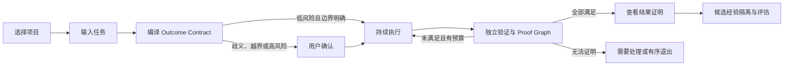

# Keystone 下一代工程 Agent Harness 产品需求文档（PRD）

**文档版本**：v1.0  
**状态**：下一代 Agent Harness 产品基线  
**产品代号**：Keystone  
**更新日期**：2026-10-19  
**目标读者**：产品、设计、研发与测试  
**竞争研究**：`docs/research/2026-10-19-agent-harness-competitive-analysis.md`  
**架构依据**：`docs/architecture/2026-10-19-keystone-next-generation-harness-architecture.md`  
**历史基线**：`docs/superpowers/specs/2026-10-19-keystone-competitive-product-design.md`

## 1. 产品定义

### 1.1 一句话定义

Keystone 是一款证据原生、本地优先的工程 Agent Harness。它持续理解项目，在用户设定的硬边界内自主完成复杂工程任务，并以可重放、可失效的独立证据证明结果达到交付条件。

### 1.2 用户价值

Keystone 向用户提供六项直接价值：

1. **更懂项目**：跨任务维护项目结构、工程规则、测试关系和历史经验，不在每次会话中重新理解仓库。
2. **结果可证**：执行前明确目标结果和不可破坏的约束，完成状态由证据判定，不由模型宣布。
3. **长期不中断**：任务状态和检查点持续保存，应用退出、模型切换或机器重启后仍可继续。
4. **自治可控**：用户定义不可突破的权限边界；系统只在边界内依据历史证据提高或降低自动化程度。
5. **越用越稳**：长期经验经过来源、适用性、冲突和负向迁移检查，不把单次推断直接升级为项目知识。
6. **开放可组合**：桌面、CLI、IDE 和 CI 共享同一运行时，并通过开放协议接入模型、工具、Skills 和外部 Agent。

### 1.3 核心差异

主流工程 Agent 已普遍具备沙箱、会话恢复、Skills、插件、Hooks、子 Agent 和并行工作区。Keystone 不以这些通用能力本身作为差异，而以**证据原生的双环运行时**组织工作：

- 会话是交互方式，不是项目记忆的边界。
- Builder Loop 负责理解、规划、执行和修改；Assurance Loop 独立控制目标、上下文、能力、验证、完成和学习。
- 任务、工作区、动作、证据和经验形成可派生、比较和重放的运行图，不依赖单一线性聊天记录。
- 模型只能提出动作和候选经验，不能自行修改目标、权限、验证结果、完成状态或长期项目认知。
- 所有上下文、工具结果、记忆和证明保留来源及信任等级；不可信内容不能在摘要或跨会话复用中获得更高权限。
- 自治程度可以依据证据变化，但用户设定的文件、命令、网络、凭证和外部系统硬边界不能自动扩大。

### 1.4 产品形态

桌面应用是普通用户的主要工作面：

- 默认打开“任务工作台”，而不是聊天首页。
- 用户按项目查看任务、项目认知、执行状态和结果证明。
- 输入框用于发起任务、补充约束或调整目标，不主导整个界面。
- 凭证、策略、证据链等技术细节默认折叠，仅在异常、越界或审计时展开。

同一 Keystone Runtime 还提供：

- CLI：用于无界面任务、恢复、诊断、评测和脚本调用。
- IDE 接入：通过开放客户端协议在兼容编辑器中使用完整任务能力。
- CI 模式：以非交互方式运行验证任务并输出机器可读证明。
- Extension SDK：接入模型、工具、项目分析器、验证器、Skills 和工作区实现。

首发产品支持 macOS、本地 Git 仓库和 BYOK 模型配置。项目数据、任务记录、运行图、缓存与项目认知默认保存在本机；调用云模型时仅发送当前步骤明确列出的上下文。

## 2. 产品合同

| 项目 | 定义 |
|---|---|
| 主要用户 | 已使用工程 Agent 处理真实代码仓库，希望减少复查和重复沟通的开发者 |
| 核心任务 | 修复缺陷、实现中小型功能、重构代码并完成对应验证 |
| 触发条件 | 用户选择本地 Git 项目并输入自然语言任务 |
| 核心对象 | 工程任务 |
| 完成条件 | 所有必需完成条件获得规定等级的有效证据，任务进入“已证明”状态 |
| 信任承诺 | 模型不能自行放宽目标、扩大权限或宣布完成 |
| 恢复承诺 | 中断后从最后一个有效检查点恢复，不要求用户重新描述任务 |
| 自治承诺 | 历史成功只能减少已授权范围内的确认，不能扩大用户硬边界 |
| 学习承诺 | 未验证或来源不可信的信息不能直接进入长期项目认知 |
| 开放承诺 | 核心任务、证据和扩展协议版本化，界面和模型可以替换 |

## 3. 用户与核心场景

### 3.1 主要用户

主要用户是委托真实工程任务给 Agent 的个人开发者和研发团队成员。他们具备以下特征：

- 已经使用 Codex、Claude Code、DeepSeek Harness 或同类工具。
- 面对中大型仓库时，Agent 经常重复读取、遗忘约束或引入范围外改动。
- 愿意委托复杂任务，但不愿持续监督每一次工具调用。
- 关注一次成功率、改动正确率、长任务连续性和模型成本。
- 希望使用自己的模型账号，并控制项目数据的存储位置。

次要用户包括：

- 为团队维护工程规则、验证器和项目适配器的资深开发者。
- 为 Keystone 开发模型、工具、语言分析、Workspace 或界面扩展的开源贡献者。
- 在 CI 中消费机器可读结果证明的代码维护者。

### 3.2 P0 场景：修复真实缺陷

用户打开项目，输入“修复登录模块 Session 过期后的重复刷新问题，并确保现有登录行为不变”。

Keystone 应完成：

1. 从项目认知和当前仓库定位相关模块、测试和历史约束。
2. 生成用户可读的目标结果、修改范围、不变量、验证计划和预算。
3. 在不需要人工确认的范围内持续执行修改与验证。
4. 验证失败时，在预算内自动定位原因并修复。
5. 仅在目标冲突、越界、不可逆动作或预算耗尽时请求用户处理。
6. 交付代码变更及结果证明，明确已验证项和剩余风险。

### 3.3 P0 场景：实现受约束功能

用户要求在现有模块内增加功能，并强调不能改变公开接口。

Keystone 应识别公开接口为不变量，约束修改范围，匹配相关测试，在交付前验证公开接口和现有行为未被破坏。

### 3.4 P0 场景：中断后继续长任务

任务执行过程中应用退出或模型不可用。用户再次打开应用后，应看到：

- 任务中断前的阶段和最近检查点。
- 已完成、待验证和待执行的步骤。
- 已使用和剩余预算。
- 恢复所需的仓库一致性检查结果。

仓库状态一致时，用户可直接继续；状态已变化时，Keystone 必须先说明影响并重新计算计划。

## 4. 版本范围

### 4.1 P0：证据原生单项目闭环

- macOS 桌面工作台、CLI 和同一版本的本地 Runtime。
- 本地 Git 项目接入、工作区快照和基础 Project World Model。
- Outcome Contract 编译、修订、冲突提示和版本化。
- Branchable Run Graph、检查点、暂停、恢复、派生和状态重放。
- 文件、代码搜索、编辑、独立命令执行、Git 和工作区操作。
- 用户硬边界、Capability Lease、范围检查和非模态人工介入。
- Context Plan、来源展示、预算记录和最小上下文构建。
- 测试、类型检查、Lint、构建、范围、diff 和项目规则验证。
- Proof Graph、结果证明、证据失效和有限自动修复。
- Experience Firewall、候选经验隔离、严格失效和用户纠正。
- 一个云模型兼容接口、本地模型兼容接口和模型切换。
- 机器可读 Contract、事件、Evidence 和 Proof 格式。
- 扩展 Manifest、最小 Model/Tool/Verifier SDK 和一致性测试。

### 4.2 P1：跨界面、隔离并行与生态

- ACP 兼容 IDE 接入和 CI 非交互运行。
- 多个本地项目的统一管理。
- Worktree 或独立 Workspace 隔离的并行写任务。
- 按收益启用且上下文、权限隔离的子 Agent。
- Project Analyzer、Workspace Runtime 和 Protocol Adapter SDK。
- MCP 与 Agent Skills 接入及 Harness Lab。
- 第二批编程语言和工程框架适配。
- 对比验证、隔离重放、变异检查和更丰富的语义验证。
- 经验的正向迁移、负向迁移和遗忘评测。

### 4.3 P2：远程协作与开放生态

- A2A 兼容的远程 Agent 委派。
- 远程和集群 Workspace Runtime。
- 团队共享的项目规则、经验和证明。
- 签名证明、外部可信验证和跨机器重放。
- 验证器、规则、Workspace 和经验模板生态。
- 多 Agent 分支比较、受控合并和任务图协作。

### 4.4 当前不包含

- 通用日常办公 Agent。
- 以 Agent 数量为目标、默认启用的多 Agent 软件工厂。
- 企业集中式 Web 管理后台。
- 移动端和远程签署。
- 自动支付、邮件发送和生产部署。
- 未经隔离、一致性测试和权限声明的插件或 Skill 市场。
- 自动将单次失败升级为长期项目规则。
- 允许扩展替换状态机、权限签发、证据完整性或完成判定。
- 以模型思维链作为证明、审计记录或用户交付物。

## 5. 术语与核心对象

### 5.1 用户可见术语

| 术语 | 定义 |
|---|---|
| 项目 | 用户选择的本地 Git 工作区及其项目认知 |
| 工程任务 | 一次具有明确目标、范围和完成条件的工作 |
| 目标结果 | 任务完成后必须成立的用户可观察结果 |
| 修改范围 | Agent 可以读取、修改或调用的资源边界 |
| 完成条件 | 判断任务能否交付的检查项 |
| 项目认知 | Keystone 持续维护的项目结构、规则、测试关系和历史经验 |
| 检查点 | 可以恢复任务的持久状态 |
| 结果证明 | 说明改了什么、为何可交付、验证了什么及剩余风险的交付包 |
| 自治边界 | 用户允许 Keystone 自动行动的最大文件、命令、网络、凭证和成本范围 |
| 运行分支 | 从同一检查点派生、可独立执行和比较的任务路径 |
| 上下文计划 | 说明本步骤采用和排除了哪些信息、原因、来源及成本的记录 |

### 5.2 内部对象

| 对象 | 产品含义 |
|---|---|
| Outcome Contract | 目标结果、范围、不变量、验证计划、预算和退出条件的结构化定义 |
| Project Fact | 带来源、适用版本和失效条件的项目事实 |
| Context Capsule | 当前执行步骤所需的最小可信上下文 |
| Context Plan | Context Capsule 的选择计划、来源、预算、排除项和失效依据 |
| Branchable Run Graph | 连接任务、检查点、动作、工作区、证据和经验的可派生运行图 |
| Capability Lease | 绑定主体、能力、资源、参数、预算和有效期的短期执行授权 |
| Provenance Record | 信息来源、信任等级、派生关系、适用快照和失效条件 |
| Evidence Record | 工具或验证器生成的原始结果及来源信息 |
| Proof Graph | 完成条件、证据、依赖、冲突、失效和独立性组成的证明图 |
| Experience Entry | 已验证且可失效的成功经验或失败路径 |
| Experience Candidate | 尚在隔离、不能直接用于长期复用的候选经验 |
| Proof Package | 面向用户的结果证明及其证据引用 |

自然语言界面是这些对象的展示方式，不是事实真相源。

## 6. 核心用户旅程

1. 用户选择或首次接入项目。
2. Keystone 展示项目认知状态，用户输入任务。
3. Keystone 编译并展示目标结果、修改范围、不变量、完成条件、证据要求、自治边界和预算。
4. 无重大歧义、高风险动作和范围扩大时，任务可按用户默认策略直接执行；否则请求确认。
5. Keystone 为每一步生成 Context Plan，模型提出动作，Runtime 在 Capability Lease 范围内执行。
6. 每个重要动作写入运行图并绑定工作区快照、来源和预算。
7. 验证未满足时，Keystone 在预算内自动修复，或从检查点派生替代分支进行比较。
8. 只有 Proof Graph 对全部必需条件形成有效支持路径后，任务才能标记为“已证明”。
9. 用户查看结果证明，可打开变更、上下文依据、原始证据、分支差异和复现命令。
10. 成功轨迹只能生成候选经验；通过来源、适用性和负向迁移检查后才能进入项目认知。

## 7. 任务生命周期

### 7.1 状态定义

| 状态 | 含义 | 用户可执行操作 |
|---|---|---|
| 草稿 | 用户正在输入任务，尚未生成结果定义 | 编辑、取消 |
| 定义中 | 正在构建项目上下文并编译结果定义 | 取消、查看进度 |
| 待开始 | 已生成结果定义，可以直接运行 | 开始、修改、取消 |
| 待确认 | 存在高风险、重大歧义或不可逆动作 | 确认、修改、拒绝 |
| 执行中 | 正在规划、修改或调用工具 | 暂停、停止、补充约束 |
| 验证中 | 正在检查完成条件 | 暂停、停止、查看证据 |
| 自动修复中 | 验证未满足，正在预算内修复 | 暂停、停止、查看原因 |
| 需要处理 | 目标冲突、越界、预算耗尽或无法判断 | 补充信息、调整范围、退出 |
| 已暂停 | 用户主动暂停或系统等待恢复 | 恢复、修改目标、停止 |
| 恢复校验中 | 正在核对运行图、工作区、扩展和证据状态 | 查看影响、停止 |
| 已证明 | 所有必需完成条件均满足 | 查看结果、导出证明 |
| 有序退出 | 达到退出条件，已保存当前结果和原因 | 查看结果、创建后续任务 |
| 失败 | 出现不可恢复错误 | 查看原因、从检查点重试 |
| 已停止 | 用户主动终止 | 查看已产出内容、重新发起 |

### 7.2 状态规则

- “执行中”和“验证中”必须显示当前是否需要用户处理。
- 验证失败不会立即进入“失败”，而是进入有限的自动修复循环。
- 任何范围扩大都必须暂停相关动作；确认前不得执行。
- 应用或 Daemon 崩溃不能直接改变任务业务状态。
- “已证明”状态不可由模型文本触发，只能由完成条件判定触发。
- 用户修改目标结果、范围或完成条件后，系统必须创建新版本并重新判断受影响的步骤和证据。
- 任何执行、验证、恢复和经验晋升状态变化都必须由内核事件触发，界面和扩展不能直接改写状态。
- `执行中`、`验证中`和`自动修复中`可以进入`已暂停`或`已停止`；恢复前必须进入`恢复校验中`。
- 从检查点派生替代方案会创建新的运行分支，不覆盖原分支。
- `已证明`后工作区或依赖发生相关变化时，任务历史状态保持不变，但当前证明标记为“已失效”。

### 7.3 关键状态转换

| 来源状态 | 事件 | 前置条件 | 目标状态 | 失败处理 |
|---|---|---|---|---|
| 草稿 | 提交任务 | 项目可读取 | 定义中 | 保留草稿并显示原因 |
| 定义中 | Contract 编译完成 | 必需字段完整 | 待开始或待确认 | 无法判断时进入待确认 |
| 待开始 | 开始或自动开始 | 边界明确且策略允许 | 执行中 | 进入需要处理 |
| 待确认 | 用户允许 | 决定仍适用于当前版本 | 执行中 | 决定过期则重新确认 |
| 执行中 | 请求验证 | 存在可执行验证计划 | 验证中 | 阻塞项进入需要处理 |
| 验证中 | 必需条件未满足 | 有修复预算和可行路径 | 自动修复中 | 无可行路径则有序退出 |
| 自动修复中 | 产生有效修改 | Contract 未变化 | 执行中 | 无进展则需要处理 |
| 任一活动状态 | 暂停 | 当前动作可安全停止 | 已暂停 | 先等待不可中断动作结束 |
| 已暂停或崩溃状态 | 恢复 | 存在完整检查点 | 恢复校验中 | 无完整检查点则失败 |
| 恢复校验中 | 一致性通过 | 工作区与账本可解释 | 原活动状态 | 变化可重算则建立新分支 |
| 验证中 | Proof 查询通过 | 全部必需条件有有效证据 | 已证明 | 任一证据失效则不得完成 |

## 8. 功能需求

### 8.1 项目接入与 Project World Model

#### PI-01 接入本地项目（P0）

**触发**：用户首次选择本地 Git 工作区。

**产品行为**：

1. Keystone 建立当前工作区快照，识别项目基本结构、语言、包管理方式、构建与测试入口。
2. 系统展示接入进度及已识别内容，不阻塞用户查看项目。
3. 基础识别完成后，项目进入“可发起任务”状态。
4. 无法识别的命令或规则标记为“未识别”，不使用猜测值替代。
5. 系统说明当前语言、框架、仓库规模和工具版本是否在支持矩阵内。

**结果**：

- 项目出现在左侧项目列表。
- 用户可以查看项目认知的同步时间、覆盖范围、来源类型、当前快照和异常。

**异常与恢复**：

- 路径不存在或无读取权限时，说明具体原因并允许重新选择。
- 工作区不是 Git 仓库时，首发版本阻止接入并说明要求。
- 索引中断后可以继续，不从零重新处理未变化内容。
- 工作区存在未提交或未跟踪修改时，系统必须展示并将其纳入快照，不得覆盖或误认为 Agent 变更。

#### PI-02 维护项目事实（P0）

Keystone 维护以下项目事实：

- 目录、模块、包和入口关系。
- 符号定义、引用和依赖关系。
- 测试与实现的关联。
- 构建、检查和运行命令。
- 项目规则、模块边界和用户确认的例外。
- 历史任务中的已验证经验与失败路径。

每个事实必须记录内容、来源、派生关系、适用快照、信任等级、新鲜度和失效条件。相关代码、配置、依赖、工具版本或 Git 状态变化后，系统必须将受影响事实标记为待更新或失效。

事实冲突时采用以下顺序：

1. 用户明确确认且未过期的规则。
2. 当前工作区和确定性工具直接观察。
3. 项目中版本化的规则文件与配置。
4. 已验证且仍适用的历史经验。
5. 模型推断。

低优先级来源不能静默覆盖高优先级来源。模型推断只能作为当前任务假设，不能直接成为 Project Fact。

#### PI-03 查看与纠正项目认知（P0）

用户可以：

- 查看项目认知摘要和来源。
- 搜索模块、规则和历史经验。
- 纠正错误事实。
- 冻结用户确认的规则，避免被自动更新覆盖。
- 删除不应继续复用的经验。
- 查看事实之间的依赖以及哪些任务、上下文和证据正在引用该事实。

用户纠正后，正在运行且受影响的任务必须重新评估上下文和计划。

#### PI-04 维护时序关系与精确失效（P0）

Project World Model 必须区分：

- 事实何时在项目中成立。
- 系统何时观察或更新该事实。
- 事实适用于哪个 Git、工作区、依赖和工具快照。

目录、符号、测试、规则和经验之间保留关系。某个源文件、配置或依赖变化时，系统只失效受影响的事实、Context Plan 和 Evidence，不因局部变化强制重建全部项目认知。

#### PI-05 兼容项目指令（P0）

系统识别并展示仓库中的 `AGENTS.md` 及其他受支持的 Agent 指令文件。不同来源的指令按作用域和路径匹配，冲突时明确展示，不把指令文件视为可扩大权限或修改完成条件的授权。

### 8.2 创建任务与定义结果

#### OT-01 创建工程任务（P0）

**触发**：用户在已接入项目中输入自然语言任务。

**产品行为**：

- 系统结合当前仓库和项目认知理解任务。
- 输入支持引用文件、目录、Issue 文本或错误日志。
- 系统在同一项目内创建独立任务，不复用其他任务的临时推断。

**结果**：任务进入“草稿”，随后生成结果定义。

#### OT-02 编译目标结果（P0）

系统生成并展示：

| 字段 | 展示要求 |
|---|---|
| 目标结果 | 一句话描述任务完成后应成立的结果 |
| 修改范围 | 允许修改的模块、目录或文件；未知时明确标记 |
| 不变量 | 不允许破坏的接口、行为或架构规则 |
| 完成条件 | 可逐项验证的检查项 |
| 证据要求 | 每个必需条件所需的最低证据等级和独立性 |
| 预算 | 时间、Token、重试和必要外部成本 |
| 自治边界 | 可自动执行的文件、命令、网络、凭证和外部动作上限 |
| 不确定项 | 当前无法从用户输入或项目事实确定的关键判断 |
| 介入条件 | 什么情况下会暂停并询问用户 |
| 退出条件 | 什么情况下停止继续尝试 |

系统发现输入与项目规则冲突时，必须在开始前指出冲突。无重大歧义、无高风险动作且范围明确时，可直接进入“待开始”；否则进入“待确认”。

#### OT-03 修订结果定义（P0）

用户可以用自然语言或结构化字段修改目标结果、范围、完成条件和预算。

- 每次修订生成新版本。
- 修订前已产生的证据继续保留，但只有仍符合新版本条件的证据可用于完成判定。
- 范围缩小时，超出新范围的未提交修改必须被标记并阻止继续扩展。
- 范围扩大时，进入人工确认。
- 系统展示修订会使哪些步骤、运行分支、能力租约、证据和经验候选失效。
- 修订不能删除历史版本或改变历史决定记录。

#### OT-04 导入和导出 Outcome Contract（P0）

用户可以查看和导出机器可读 Contract。CLI、桌面、IDE 和 CI 对同一 Contract Schema 的解释必须一致。导入旧版本 Contract 时，系统先执行兼容性检查和迁移预览；不能可靠迁移时禁止执行。

### 8.3 Context Plan、来源与成本控制

#### CX-01 生成可解释 Context Plan（P0）

每个执行步骤只加载完成该步骤所需的代码、项目事实、历史经验和任务约束。

Context Plan 必须记录：

- 采用的上下文项、来源、适用快照和信任等级。
- 被排除的高相关候选及排除原因。
- 每类上下文的 Token 成本和预算占比。
- 本步骤依赖的项目事实和经验。
- 触发重新构建 Context Plan 的失效条件。

用户可以查看本步骤使用了哪些来源和选择理由，但默认不展示完整上下文内容。系统不得把未经验证的模型推断写入长期项目认知。

#### CX-02 复用缓存与经验（P0）

缓存命中时，系统必须记录：

- 命中的内容和来源。
- 与当前仓库状态的匹配依据。
- 节省的重复读取或模型输入。
- 失效条件。
- 当前任务与经验的关系、预期帮助和潜在冲突。

如果仓库版本、相关文件、依赖、配置、工具状态或适用任务关系不再匹配，系统必须放弃命中。缓存未命中是正常状态，不得为了展示高命中率使用低置信结果。

未经 Experience Firewall 晋升的候选经验不能进入执行上下文；存在负向迁移记录、冲突或来源污染时，默认不采用。

#### CX-03 展示成本和预算（P0）

任务详情持续展示：

- 已使用和剩余 Token 预算。
- 已执行和剩余重试次数。
- 上下文复用率。
- 有效复用、无效复用和负向复用次数。
- 预计新增成本发生的原因。

预算接近上限时，系统优先缩小上下文和停止低收益尝试；预算耗尽后进入“需要处理”或“有序退出”。

#### CX-04 上下文压缩与来源保真（P0）

上下文压缩、摘要和子 Agent 汇总必须保留关键来源、信任等级、未解决冲突和 Contract 约束。压缩不能把不可信内容转换为系统规则，也不能丢失会改变权限、完成条件或风险判断的信息。

### 8.4 工程执行

#### EX-01 持续执行任务（P0）

任务开始后，Keystone 按“理解、规划、授权、修改、验证、交付”组织执行轨迹。

- 轨迹展示可理解的动作摘要、影响文件和状态，不展示原始思维链。
- 普通文件读取、范围内编辑、已批准命令和验证失败不打断用户。
- 每个重要阶段保存检查点。
- 用户可以随时暂停、停止或补充约束。
- 模型生成的是 Action Proposal；只有获得有效 Capability Lease 后才允许执行。

#### EX-02 文件与命令操作（P0）

首发支持：

- 读取和搜索项目文件。
- 创建、修改和删除修改范围内的文件。
- 运行项目命令；默认每个命令作为独立动作执行，不依赖不可恢复的隐式 Shell 状态。
- 查看 Git 状态和 diff。
- 执行测试、类型检查、Lint 和构建。

所有有副作用的操作必须经过统一执行边界。未授权能力、范围外资源和不允许的网络访问默认拒绝。

每个有副作用动作必须记录动作提案、Capability Lease、实际参数、执行环境、输出、退出状态和工作区变化。

#### EX-03 控制修改范围（P0）

- 系统在每次写入前检查当前任务范围。
- 范围外写入必须暂停，并展示拟修改资源、原因和风险。
- 用户拒绝扩大范围后，系统可以寻找范围内替代方案；不存在替代方案时有序退出。
- 完成前再次检查实际变更范围，范围外变更会阻止任务进入“已证明”。

#### EX-04 Branchable Run Graph 与检查点（P0）

检查点至少记录：

- 当前任务状态和阶段。
- 已完成、待执行和待验证步骤。
- 工作区状态摘要。
- 已使用和剩余预算。
- 关键决策与证据引用。
- 当前 Contract、运行分支、Capability Lease 和扩展版本。

恢复时，Keystone 先重放权威状态并核对工作区。状态一致则继续；状态变化则说明受影响内容，并重新计算计划、项目事实和验证范围。

用户可以从有效检查点派生运行分支。每个分支拥有独立计划、预算、工作区变化和证据。分支比较至少展示结果、成本、改动范围、验证状态和残余风险。

#### EX-05 运行模式与降级（P0）

系统提供：

- Minimal：只使用基础文件、独立命令和确定性验证，用于评测、恢复和故障隔离。
- Standard：使用项目认知、Context Plan、工具、验证和经验。
- Isolated：在隔离 Workspace 中执行高风险或需要复现的任务。
- Replay：只执行状态、验证或执行重放。

高级能力失败时，系统可以在说明能力损失和证据影响后降级；不得静默降级后继续声称同等级证明。

#### EX-06 子 Agent（P1）

系统仅在子任务可独立验证、文件修改不冲突且并行收益高于成本时创建子 Agent。用户可以看到子任务、范围、预算和结果。

子 Agent 不自动继承父任务的全部上下文和权限。每个子 Agent 必须获得独立 Context Plan、Capability Lease、预算和完成条件；输出默认视为 Observation，需要父任务验证后才能合并。

### 8.5 验证与自动修复

#### VF-01 执行完成条件（P0）

系统按结果定义逐项执行验证。首发验证类型包括：

- 目标测试。
- 相关回归测试。
- 类型检查。
- Lint。
- 构建。
- Git diff 与修改范围检查。
- 项目规则和模块边界检查。

每一项显示“待执行、执行中、通过、未通过、阻塞、失效”状态。

验证计划同时说明：

- 验证器生产者和版本。
- 运行环境与工作区快照。
- 是否独立于 Builder Loop 的模型、进程、工作区或数据源。
- 证据有效期和失效条件。

#### VF-02 证据等级（P0）

| 等级 | 含义 | 是否可单独满足完成条件 |
|---|---|---|
| E0 模型声称 | 模型描述预期结果 | 否 |
| E1 工具记录 | 普通命令输出或 diff | 仅用于低风险辅助项 |
| E2 受控执行结果 | 受限环境中的测试、构建或范围检查 | 是，按完成条件要求 |
| E3 独立受控复核 | 隔离工作区重放、对比验证或独立验证器结果 | 是，按完成条件要求 |
| E4 外部可信证明 | CI、受控服务、签名回执或多方复核 | 是，用于高风险条件 |

结果定义必须为每个必需完成条件指定最低证据等级。模型不能创建或修改验证结果。

#### VF-03 自动修复循环（P0）

验证未通过时：

1. 系统展示未满足条件和失败证据。
2. 在预算内定位原因并修改。
3. 只重跑受影响检查；完成前仍需执行规定的最终验证。
4. 需要比较不同修复路径时，可以从同一检查点派生分支。
5. 连续尝试无有效进展时停止消耗预算，进入“需要处理”或“有序退出”。

系统不得通过删除测试、跳过检查、放宽断言或修改完成条件制造通过。

#### VF-04 Proof Graph 与完成判定（P0）

任务仅在以下条件全部满足时进入“已证明”：

- 所有必需完成条件通过。
- 证据达到规定等级且未失效。
- 实际改动未超出最终范围。
- 证据链完整。
- 当前工作区与验证时状态一致。
- 需要独立性的条件满足对应的模型、进程、工作区或数据源隔离。
- Proof Graph 中不存在未解决的冲突、循环依赖或已失效上游节点。

每个完成条件必须能从摘要逐层追溯到 Evidence、Validator、Workspace Snapshot 和原始 Observation。

#### VF-05 对比和反事实验证（P1）

对适合的缺陷修复或高风险改动，系统支持：

- 证明目标测试在基线失败、在候选变更通过。
- 对比候选分支的行为、成本和证据。
- 使用变异、回滚或独立实现检查验证器是否具有判别能力。
- 防止 Agent 通过修改测试入口、跳过检查或改变基线制造通过。

#### VF-06 证据失效（P0）

工作区、依赖、工具、验证器、Contract 或关键 Project Fact 变化时，系统沿 Proof Graph 精确标记受影响证据。历史任务仍保留当时的“已证明”记录，但当前可用性显示为“有效”“部分失效”或“已失效”。

### 8.6 结果证明与交付

#### DP-01 生成结果证明（P0）

结果证明必须包含：

- 修改内容和影响范围。
- 完成条件及逐项状态。
- 测试、类型检查、Lint、构建和范围证据。
- 使用的关键项目规则。
- 采用的关键 Context Plan、经验和模型路由决定。
- 运行分支以及选择该分支的依据。
- 关键 Capability Lease 和人工决定。
- 未验证项和残余风险。
- 用户可执行的复现命令。

摘要必须使用开发者可理解的语言；原始命令、输出、时间和环境信息可以逐层展开。

#### DP-02 查看变更与证据（P0）

用户可以从结果证明：

- 打开具体 diff。
- 查看完成条件引用的证据。
- 查看证据产生时间、环境和当前是否仍有效。
- 复制复现命令。
- 将有价值的修正反馈为项目规则或候选经验。
- 查看证据依赖、独立性和失效原因。
- 比较不同运行分支。

#### DP-03 导出机器可读证明（P0）

用户可以导出结构化结果证明，用于代码评审、CI 或外部审查。脱敏导出可以隐藏文件内容，仅保留摘要、哈希、状态和引用。

#### DP-04 外部证明与签名（P2）

外部验证器可以返回带身份、环境和完整性信息的证明。签名只证明来源和完整性，不自动证明结果正确；系统仍按 Contract 的最低证据要求判断是否采信。

### 8.7 经验学习

#### LE-01 生成候选经验（P0）

以下信息可以成为候选经验：

- 已验证的定位路径。
- 成功补丁模式。
- 测试与实现映射。
- 已确认的失败原因。
- 无效尝试及其适用条件。

模型自述、未验证推断和一次偶然失败不能直接成为长期规则。

所有候选经验先进入隔离区，默认不参与后续任务。

#### LE-02 晋升项目经验（P0）

候选经验满足以下任一条件后可以晋升：

- 在多个任务中被独立验证。
- 用户明确确认。
- 能从项目事实和确定性工具结果直接推导。

晋升后的经验必须保留来源、适用范围和失效条件。用户可以冻结、纠正或删除。

#### LE-03 选择性经验使用（P0）

经验进入 Context Plan 前必须检查：

- 与当前任务、模块和交互结构的关系。
- 当前工作区和工具版本是否适用。
- 是否存在冲突、反驳证据、过期或污染。
- 历史使用是否产生正向迁移、负向迁移或遗忘。

系统记录采用和排除理由。经验的使用效果必须回写为独立评估记录，不能由生成该经验的模型自行判定。

#### LE-04 经验降级与撤销（P0）

出现以下任一情况时，经验进入降级或隔离状态：

- 在适用范围内导致验证失败或范围外修改。
- 被当前项目事实或用户确认规则反驳。
- 来源或派生链被标记为不可信。
- 适用版本、工具或依赖发生不兼容变化。
- 长期评测发现负向迁移或遗忘超过发布门禁。

删除或撤销经验后，后续任务不能再引用；正在运行的受影响任务必须重新构建 Context Plan。

### 8.8 人工介入、能力与自治

#### HI-01 非模态介入入口（P0）

待处理事项在标题栏和任务列表显示数量。用户打开右侧介入区域后，仍可查看其他任务。

每个待处理事项必须说明：

- 为什么需要用户。
- 不处理会发生什么。
- 系统建议的处理方式。
- 允许、拒绝或修改后影响的范围与预算。

#### HI-02 介入触发规则（P0）

仅在以下情况请求用户：

- 目标存在会显著改变实现的歧义。
- 需要扩大文件、命令、网络或凭证范围。
- 动作不可逆或影响外部系统。
- 结果定义中的约束互相冲突。
- 预算耗尽，继续执行需要追加资源。
- 系统无法通过规定方式判断正确性。

#### HI-03 风险动作确认（P0）

确认必须绑定当前任务、具体能力、参数、范围和有效期。确认一次任务不代表其他任务或子 Agent 自动获得相同权限。

拒绝后，系统保留拒绝原因和当前检查点，并寻找不需要该权限的替代路径。

#### HI-04 Autonomy Envelope（P0）

用户可以按项目设置可自动执行的最大边界，包括文件、命令、网络、凭证、外部系统、可逆性和预算。该边界是硬上限：

- 模型、插件、历史成功和项目内容都不能自动扩大。
- 范围扩大必须创建具体、可回看的用户决定。
- 子 Agent 和扩展只能获得更小的 Capability Lease。
- 用户可以随时收窄或撤销边界；受影响动作在下一个副作用前停止。

#### HI-05 Evidence-Based Autonomy（P1）

系统可以在 Autonomy Envelope 内，根据 Contract 清晰度、动作可逆性、项目新鲜度和历史验证结果减少或增加确认频率。

自治变化必须展示：

- 变化适用的项目、能力、模型、工具和扩展版本。
- 增加或降低的依据。
- 有效期和衰减条件。
- 撤销入口。

模型升级、插件升级、连续失败、回滚、负向经验或长期未使用会降低自治。证据驱动自治不能自动批准外部高风险动作。

### 8.9 任务工作台

#### UI-01 四区工作台（P0）

工作台采用以下固定职责：

| 区域 | 主要内容 |
|---|---|
| 标题栏 | 当前项目、分支、全局运行状态和待处理数量 |
| 左侧 | 项目、并行任务、项目认知和经验缓存状态 |
| 中间 | 目标结果、范围、运行分支、完成条件、执行阶段和关键轨迹 |
| 右侧 | Proof Graph、证据、风险、自治和人工介入 |
| 底部 | 补充约束输入、Workspace 状态、模型路由和成本摘要 |

后续视觉设计可以调整尺寸、样式和响应式行为，但不得改变区域职责和信息优先级。

#### UI-02 任务列表（P0）

任务按“需要处理、运行中、等待、已完成、已退出”组织。每项至少展示任务名称、状态、项目和最近更新时间。

切换任务时，目标、工作区、项目认知和证据必须保持隔离，不得出现其他任务的临时状态。

#### UI-03 执行轨迹（P0）

执行轨迹默认展示：

- 当前阶段和步骤。
- 最近关键动作。
- 修改文件数量。
- 检查点。
- 当前运行分支和父检查点。
- Context Plan 与 Capability Lease 摘要。
- 验证与修复状态。

详细工具调用按需展开。原始思维链不展示。

#### UI-04 结果证明面板（P0）

右侧面板按完成条件展示验证进度。用户无需阅读原始日志即可判断：

- 哪些条件已满足。
- 哪些条件仍在运行或失败。
- 当前是否需要用户处理。
- 是否可以安全交付。
- 证明是否仍适用于当前工作区。

#### UI-05 输入区（P0）

输入区支持：

- 发起新任务。
- 为当前任务补充信息。
- 增加约束。
- 请求调整目标结果。

任务执行过程中发送的内容不能直接改变结果定义；系统必须先展示变更影响并生成新版本。

### 8.10 设置与数据管理

#### ST-01 BYOK 模型配置（P0）

用户可以配置兼容的云模型或本地模型。系统说明各模型用途、连接状态和数据发送范围。

切换模型不得改变当前任务的目标、权限、状态和完成条件。

系统在发送前展示本步骤拟发送的数据类别、来源、目标提供方和预计 Token。模型提供方变化会使依赖模型一致性的缓存和证据重新评估。

#### ST-02 本地数据管理（P0）

用户可以查看和清理：

- 项目认知。
- 经验缓存。
- 历史任务。
- 原始证据负载。
- 运行图和工作区快照引用。
- 扩展数据、自治记录和评测记录。

删除数据前显示影响范围。删除项目认知或缓存不能删除代码仓库内容。

#### ST-03 运行时与协议兼容（P0/P1）

- 桌面和 CLI 使用相同 Keystone Run Protocol。
- P0 提供版本化 Schema 和能力协商。
- P1 提供 ACP、MCP、Agent Skills 和 Open Responses 兼容适配。
- P2 提供 A2A 兼容远程 Agent 接入。

协议适配器不能改变 Keystone 的 Contract、Lease、Provenance、Evidence 和完成语义。不能表达的语义必须明确降级或拒绝，不能静默丢弃。

### 8.11 开放扩展

#### PL-01 Extension Manifest（P0）

模型、工具、项目分析器、验证器、Workspace 和协议扩展必须声明：

- 名称、版本、发布者和完整性信息。
- 所需能力、资源、副作用、网络和凭证。
- 输入输出 Schema、数据分类和可能的数据出站。
- 可产生的 Observation 和 Evidence 类型。
- 可重放性、幂等性、依赖、冲突和卸载行为。

#### PL-02 扩展激活与隔离（P0）

扩展安装或升级必须经过完整性检查、依赖解析、一致性测试、风险展示和用户确认。扩展可以增加限制或请求确认，不能自行授予权限或替换内核完成规则。

扩展崩溃、超时、违反 Manifest 或产生不兼容事件时，系统隔离扩展并保留任务检查点；可以安全降级时切换到 Minimal 或 Standard 能力，不能安全降级时进入“需要处理”。

#### PL-03 Harness Lab（P1）

贡献者可以在不影响正式项目数据的环境中：

- 检查当前 Runtime 的能力和协议版本。
- 临时挂载扩展并运行一致性、安全和重放测试。
- 比较启用前后的成功率、成本、恢复和安全指标。
- 生成可随扩展发布的兼容性证明。

## 9. 共享规则

### 9.1 完成规则

- “Agent 已完成”“逻辑应当正确”等文本不构成完成。
- 所有必需条件满足前，不显示成功状态。
- 存在未验证项时，任务只能“有序退出”或“需要处理”，不能“已证明”。
- 结果定义修订后，系统重新判断旧证据是否适用。
- Agent Loop 停止、模型返回最终消息、命令退出码为 0 或计划步骤全部勾选，都不能单独构成完成。
- `已证明`是 Proof Graph 针对当前 Contract 和 Workspace Snapshot 的查询结果。
- 历史任务可以保留“当时已证明”，但当前依赖变化后必须显示证明已失效。

### 9.2 项目认知规则

- 项目认知只接收可追溯事实、已验证经验和用户确认规则。
- 每项内容都有来源和失效条件。
- 项目认知过期时，界面明确显示，不静默继续使用。
- 不同 Git 工作区的临时状态不能混合。
- Project Fact、Experience Entry 和模型临时推断必须使用不同对象和信任等级。
- 用户确认规则不能被自动索引或经验晋升覆盖；仓库事实与用户规则冲突时请求处理。

### 9.3 缓存规则

- 缓存命中必须可以解释。
- 过期、冲突或低置信结果按未命中处理。
- 缓存节省量仅统计实际避免的读取或模型输入，不使用估算值冒充实际值。
- 用户删除缓存后，后续任务不得继续引用已删除条目。
- 缓存只能提高性能，不能改变 Contract、权限、状态转换和完成判定结果。
- 系统分别统计有效命中、无效命中和导致返工的负向命中。

### 9.4 来源传播规则

- 仓库、网页、Issue、工具输出、插件、模型、用户和历史经验使用不同来源类型。
- 摘要、压缩、缓存、子 Agent 返回、Skill 输出和格式转换必须保留来源、信任等级和派生关系。
- 转换可以增加限制，不能静默提升信任。
- 不可信内容不能直接成为系统策略、Capability Lease、完成条件或长期经验。
- 删除或隔离被污染来源时，系统必须找到并重新评估其派生的 Context Plan、Evidence 和 Experience。

### 9.5 人工介入与自治规则

- 同一轮多个待处理事项可以一次展示，但用户必须能逐项决定。
- 所有范围扩大均生成可回看的决定记录。
- 凭证过期后不能用于新动作。
- 子 Agent 权限不得宽于父任务分配的子范围。
- Autonomy Credit 只能影响已授权范围内的确认频率，不能增加权限。
- 自治依据失效或连续失败时，系统自动收紧确认策略并说明原因。
- 扩展不能通过 Hook、Skill、项目配置或模型提示绕过用户硬边界。

### 9.6 并行任务与分支规则

- 同一工作区默认只允许一个写任务。
- 只读任务可以并行，但必须绑定读取快照；活动写任务改变相关文件后，只读结果标记为可能过期。
- 多个写任务必须使用相互隔离的 Workspace。
- 外部人工修改触发工作区一致性检查。
- 运行分支不能直接覆盖其他分支；合并前必须执行冲突、范围和受影响验证。
- 子 Agent 完成不代表父任务完成，其结果必须进入父任务的验证和 Proof Graph。

### 9.7 扩展规则

- 扩展必须通过 Manifest、兼容性检查和一致性测试后才能激活。
- 扩展不能修改已有事件、Evidence、用户决定或历史 Contract。
- 扩展升级后，新动作使用新版本；旧证据保留原生产者版本并重新判断有效性。
- 禁用或卸载扩展不能使任务状态丢失；无法解释的扩展事件使相关任务进入“需要处理”。
- Skills 和 MCP 内容视为不可信能力输入，不因安装来源自动获得项目权限。

## 10. 异常与恢复

| 情况 | 用户可见行为 | 系统规则 |
|---|---|---|
| 应用或 Daemon 崩溃 | 显示恢复状态和最近检查点 | 验证账本与工作区后恢复 |
| 项目认知过期 | 标记受影响事实和任务 | 重新处理必要部分 |
| 缓存冲突 | 显示放弃命中的原因 | 不使用冲突结果 |
| 验证失败 | 显示失败条件和修复进度 | 在预算内有限重试 |
| 多次修复无进展 | 显示需要用户或有序退出 | 停止无效消耗 |
| 模型不可用 | 保持任务状态 | 切换兼容模型或等待 |
| 请求扩大范围 | 显示新增范围、原因和风险 | 确认前暂停相关动作 |
| 证据链不完整 | 显示“结果不可证明” | 禁止进入“已证明” |
| 工作区外部变化 | 显示变化及影响 | 重新计算计划与验证范围 |
| 用户停止任务 | 保留已产出内容和证据 | 进入“已停止”，不继续调用工具 |
| Runtime 事件重放不一致 | 显示状态不可恢复 | 停止执行并保留诊断证据 |
| 扩展崩溃或违反 Manifest | 标记扩展异常和受影响步骤 | 隔离扩展并恢复到安全检查点 |
| 经验被证明有害或过期 | 显示受影响任务和上下文 | 降级经验并重新构建 Context Plan |
| 来源被判定污染 | 显示派生事实、证据和经验 | 隔离派生链并重新验证 |
| 模型切换能力不兼容 | 显示无法保留的能力 | 使用兼容模式、创建分支或等待 |
| 磁盘或证据存储不足 | 显示无法继续保留的内容 | 停止产生副作用，不伪造检查点或证明 |

## 11. 安全、隐私与数据边界

### 11.1 默认拒绝

未在当前任务范围中明确允许的文件写入、命令、网络、凭证和外部系统操作默认拒绝。

### 11.2 工具与内容不可信

工具描述、仓库内容、网页内容、Issue 文本和命令输出均可能包含恶意指令。Keystone 不将这些内容视为修改任务目标、权限或完成条件的授权。

来源不可信状态必须跨摘要、缓存、长期记忆、Skill、子 Agent、共享工件和 Proof 传播。后续 benign 任务引用了受污染内容时，系统仍按原始来源判断，不能因跨会话而“洗白”来源。

### 11.3 凭证保护

- 长期凭证不展示给模型。
- 任务执行只获得与当前动作匹配的短期能力。
- Shell 不直接持有长期凭证。
- Capability Lease 只包含当前动作所需的短期句柄、资源范围和有效期。
- 扩展只能访问 Manifest 声明且用户批准的凭证；凭证不能进入模型上下文、日志、Evidence 或导出包。

### 11.4 数据主权

- 项目认知、任务状态、运行图、缓存和证据默认保存在本机。
- 使用云模型时，系统仅发送当前 Context Plan 列出的内容。
- 系统显示模型提供方、本次数据发送范围、来源类型、敏感级别和预计 Token。
- 支持完全使用本地模型的离线模式。
- 本地模式、云模型模式和远程 Workspace 模式必须明确区分，不使用“本地优先”掩盖真实出站行为。

### 11.5 高风险外部动作

首发版本不执行支付、邮件发送、生产部署和其他难以撤销的外部写操作。未来支持时，必须具备幂等标识、前后状态、服务端回执和补偿路径。

### 11.6 Harness 生命周期安全

安全要求覆盖六个阶段：

| 阶段 | 必需控制 |
|---|---|
| 配置 | 配置来源、敏感字段、降级选项和策略变化可审计 |
| 能力扩展 | 完整性、发布者、Manifest、依赖、权限和一致性测试 |
| 运行 | Prompt Injection、工具投毒、路径逃逸和数据出站控制 |
| 状态持久化 | 来源传播、候选隔离、记忆污染和跨会话触发防护 |
| 动作控制 | Capability Lease、幂等、可逆性、人工确认和回执 |
| 事故恢复 | 污染追踪、状态修复、凭证撤销、证据保留和可信恢复 |

高任务完成率不能替代安全判定。安全评测必须同时检查任务效用、攻击成功、污染持久化、检测和恢复完整性。

### 11.7 扩展与供应链

- 扩展安装源、版本、哈希和发布者信息必须可查看。
- 扩展更新不自动继承旧版本的全部信任和 Autonomy Credit。
- 项目仓库中的配置、Hook、Skill 和插件声明不能在用户信任工作区前扩大能力。
- 扩展可以增加拒绝和确认规则，不能自行增加 Allow 或关闭安全模式。
- 发现恶意或不兼容扩展后，系统支持隔离、回退、影响分析和派生状态清理。

## 12. 非功能需求

### 12.1 可靠性

| ID | 要求 |
|---|---|
| NFR-REL-01 | 已持久化的任务、结果定义、检查点和证据在单进程崩溃后不丢失 |
| NFR-REL-02 | 恢复前验证工作区和证据完整性，发现不一致时不得静默继续 |
| NFR-REL-03 | 有序退出保留退出原因、剩余条件和当前证据 |
| NFR-REL-04 | 模型切换不改变任务业务状态和完成标准 |
| NFR-REL-05 | 对同一事件图执行状态重放，得到的权威任务状态必须一致 |
| NFR-REL-06 | 派生视图、索引和缓存损坏后可从权威事件、快照和工件重建 |
| NFR-REL-07 | 扩展崩溃不能直接破坏内核状态、用户代码和其他任务 |
| NFR-REL-08 | 每个持久化写入要么完整可见，要么完全不可见，不暴露半个检查点 |

### 12.2 性能与响应

| ID | 要求 |
|---|---|
| NFR-PERF-01 | 在基线硬件和基线数据集上，工作台冷启动到可查看已持久化任务的 p95 目标为 1.5 秒以内 |
| NFR-PERF-02 | 在基线硬件和任务规模内，任务切换和证明面板打开的 p95 目标为 300 毫秒以内 |
| NFR-PERF-03 | 项目变化采用增量更新，不能因每次任务重复全量扫描而阻塞用户 |
| NFR-PERF-04 | 长任务执行不能阻塞工作台查看、暂停或停止操作 |
| NFR-PERF-05 | 用户停止后，系统在当前不可中断动作结束前不再签发新的 Capability Lease |
| NFR-PERF-06 | Context Plan 记录实际 Token、缓存和新增成本，不使用不可验证估算冒充实际节省 |

基线硬件、项目规模、冷暖状态、样本数和测量脚本在公开性能规范中版本化。没有测量条件的延迟数字不作为发布结论。

### 12.3 可理解性

- 用户不阅读技术文档也能说明当前任务目标、范围和剩余完成条件。
- 所有失败状态提供具体原因和可执行下一步。
- 技术日志、哈希和凭证细节默认折叠。
- 状态不能只依靠颜色表达。
- 用户可以从任何自动决定追溯到 Contract、来源、Lease、Evidence 或自治依据。

### 12.4 数据与资源

- 用户可以设置项目认知、缓存、历史任务和证据的保留策略。
- 清理前显示将失去的恢复、证明或复用能力。
- 空闲运行时不得持续调用模型。
- 大型工具输出使用内容寻址和分层保留，清理不能留下仍被 Proof 引用的悬空对象。
- 用户可以导出任务、Contract、运行图、Evidence、Proof 和项目认知的可迁移格式。

### 12.5 兼容性与演进

| ID | 要求 |
|---|---|
| NFR-COMP-01 | Contract、Run Event、Evidence、Proof 和 Extension Manifest 使用独立 Schema 版本 |
| NFR-COMP-02 | 支持窗口内的新 Runtime 能读取旧数据；不能迁移时提供只读导出 |
| NFR-COMP-03 | 客户端与 Runtime 启动时协商协议和能力，不能表达的语义明确降级或拒绝 |
| NFR-COMP-04 | 扩展 SDK 提供兼容性矩阵、弃用周期和 Conformance Kit |
| NFR-COMP-05 | 协议派生代码由权威 Schema 生成，不手工维护多个不一致定义 |

### 12.6 可扩展性

- 内核只固定任务状态、Contract、Lease、Provenance、Evidence、Proof 和扩展生命周期。
- 模型、工具、Workspace、分析器、验证器和界面通过稳定扩展点接入。
- 任一扩展必须可以独立禁用，不要求迁移用户代码仓库。
- Minimal Runtime 在第三方扩展全部不可用时仍能打开、诊断、导出和停止任务。

## 13. 产品成功度量

Keystone 与对照产品使用相同模型、任务、工具权限、时间和 Token 预算进行评测。

| 指标 | 定义 |
|---|---|
| 验证完成率 | 未放宽完成条件且全部条件满足的任务比例 |
| 首轮成功率 | 无用户纠正目标、无手工改代码即完成验证的任务比例 |
| 人工介入率 | 每个完成任务所需澄清、审批和纠正次数 |
| 逃逸缺陷率 | 已证明任务中被隐藏测试或后续复查发现缺陷的比例 |
| 长任务恢复率 | 中断后从检查点正确继续的比例 |
| 上下文效率 | 每个已证明任务的输入 Token、重复读取量和缓存命中率 |
| 结构质量 | 新增架构违规、重复实现、范围外改动和规则违例数量 |
| Contract 保真率 | 实际交付与用户批准目标、不变量和范围一致的任务比例 |
| Proof 可重现率 | 按证明中的环境和命令可复现关键证据的任务比例 |
| 状态重放一致率 | 中断恢复或状态重放后权威状态与原运行一致的比例 |
| Harness 增益 | 同模型、同任务、同权限和同预算下，相比 Minimal Runtime 或对照 Harness 的净改进 |
| 正向迁移 | 使用长期经验后，相似任务的验证完成和成本改善 |
| 负向迁移 | 使用长期经验后导致表现下降、返工或错误范围扩大的比例 |
| 遗忘 | 新经验加入后，旧任务族能力下降的程度 |
| 持久化风险控制 | 恶意内容经记忆、Skill、工具、摘要、子 Agent 或共享工件传播时的阻断阶段 |
| 自治校准 | 自动执行成功率、错误放行率、过度询问率和自治衰减是否匹配风险 |

### 13.1 跨阶段领先门禁

Keystone 不以功能数量声明领先。稳定版本必须在同模型、同任务、同权限、同时间和同 Token 预算下满足：

1. 在验证完成率、人工介入率、上下文成本中至少一个核心维度显著优于当前最佳可复现实验基线。
2. 逃逸缺陷率、范围外改动率和生命周期安全指标不劣化。
3. 恢复、重放和分支合并具有确定性证据。
4. 开启长期经验后可观察到正向迁移，且负向迁移和遗忘不超过发布门禁。
5. 新插件、模型、协议或策略不能破坏 Contract、Lease、Provenance、Evidence 和 Proof 不变量。

具体数值阈值由公开基线评测确定，不在没有数据时预设。

### 13.2 评测协议

- 任务集覆盖缺陷修复、受约束功能、重构、测试、前端、跨模块和长任务恢复。
- 使用隐藏验证或独立验收脚本，避免针对可见测试投机。
- 每个配置重复运行，报告方差和失败类型，不只报告最好结果。
- 固定并记录模型、Harness、插件、策略、权限、工具和环境版本。
- 同时运行 Standard 和 Minimal 模式，区分模型能力与 Harness 增益。
- 长期学习采用不同任务路径，分别评估正向迁移、负向迁移和遗忘。
- 安全评测覆盖配置、扩展、运行、持久化、动作和恢复六个阶段。

## 14. 首发验收

一个首次使用 Keystone 的开发者能够完成以下闭环：

1. 接入 TypeScript/JavaScript Git 项目并看到项目认知状态。
2. 输入一个真实缺陷或受约束功能任务。
3. 理解并按需修改目标结果、范围和完成条件。
4. 在普通范围内无需逐次审批地让任务持续执行。
5. 在应用退出并重新打开后恢复任务。
6. 从一个检查点派生替代运行分支并比较结果。
7. 看到验证失败后的自动修复过程。
8. 仅在越界、重大歧义、无法证明或预算耗尽时处理明确请求。
9. 最终获得代码 diff、Proof Graph 和逐项完成条件的结果证明。
10. 在工作区变化后看到受影响证据被精确标记为失效。
11. 在下一个相似任务中看到已晋升经验被解释性复用，候选经验不会直接进入上下文。
12. 使用 CLI 对同一任务执行状态重放或导出机器可读证明。
13. 安装一个参考扩展并看到其能力、权限、数据出站和一致性测试结果。

## 15. 产品风险

| 风险 | 用户影响 | 产品约束 |
|---|---|---|
| 项目认知过期或错误 | Agent 使用错误上下文 | 强制来源、新鲜度和增量失效 |
| 目标结果编译错误 | 正确执行了错误任务 | 用户可读结果定义与冲突提示 |
| 测试投机或伪证明 | 错误代码被标记为完成 | 保护验证规则、分级证据和独立复核 |
| 缓存污染 | 错误经验持续放大 | 只复用已验证结果并允许删除 |
| 经验负向迁移或遗忘 | 越用越差且难以察觉 | 选择性使用、效果记录、降级和路径依赖评测 |
| 跨会话持久化攻击 | 恶意内容在后续 benign 任务触发 | 来源传播、候选隔离、派生链清理 |
| 索引成本过高 | 节省的 Token 被本地成本抵消 | 按需与增量维护项目认知 |
| 多 Agent 过早启用 | 成本和失败面增加 | 单 Agent 优先，以实际收益决定并行 |
| Everything is a Plugin 导致内核失控 | 扩展可破坏状态、权限或兼容 | 稳定内核、受治理扩展、Conformance Kit |
| 事件与证据存储膨胀 | 本地磁盘和恢复成本不可控 | 内容寻址、分层保留、配额和导出 |
| 动态自治被误解为自动提权 | 用户失去边界控制 | Envelope 永不自动扩大，自治仅影响边界内确认 |
| 开放协议语义降级 | 外部客户端错误展示任务状态 | 能力协商、明确降级、禁止静默丢失语义 |
| UI 信息过载 | 用户退回聊天工具 | 任务优先、细节折叠、异常才突出治理 |
| 模型能力波动 | 同一任务表现不稳定 | BYOK、模型可替换、完成标准独立于模型 |

## 16. 产品表达

用户可见定位：

> **Keystone 持续理解项目，在可控边界内完成复杂任务，并用证据证明结果可以交付。**

内部产品原则：

> 模型提出行动，内核约束边界，证据判定完成，经验经过验证后才改变未来。

## 17. 竞争事实与产品决策

截至 2026-10-19，主流产品已经具备统一运行时、多客户端、Skills、插件、Hooks、权限、沙箱、会话恢复、工作树和子 Agent。Keystone 不把这些能力单独描述为创新。

Keystone 的产品决策是：

| 市场共识 | Keystone 基线 | Keystone 差异 |
|---|---|---|
| 多客户端共享 Agent Runtime | Desktop、CLI、IDE、CI 共用运行时 | Contract、Lease、Proof 语义跨客户端一致 |
| 会话持久化和分支 | Branchable Run Graph | 分支连接工作区、证据和经验，不只复制聊天 |
| Skills、插件和 MCP | 受治理扩展 | 扩展不能替换安全内核或自行提权 |
| 项目规则和 Auto Memory | Project World Model | 每项事实有来源、时间、适用快照和失效 |
| 测试和代码审查 | Proof Graph | 完成条件通过证据依赖图确定性判定 |
| Manual、Plan、Auto 模式 | Autonomy Envelope | 自治在硬边界内依据证据获得并衰减 |
| 历史经验复用 | Experience Firewall | 同时评估正向迁移、负向迁移和遗忘 |

完整来源和产品比较见 `docs/research/2026-10-19-agent-harness-competitive-analysis.md`。

## 18. 开源与可持续演进

### 18.1 开放边界

- Outcome Contract、Run Event、Capability Lease、Evidence、Proof 和 Extension Manifest Schema 公开。
- Runtime 协议、Extension SDK、Conformance Kit 和参考扩展公开。
- 公开评测任务格式、运行器、指标定义和版本评分卡。
- 核心安全不变量、威胁模型、ADR 和迁移策略公开。

### 18.2 贡献路径

贡献者可以独立贡献：

- 模型适配器。
- 工具与 MCP 适配器。
- Project Analyzer。
- Workspace Runtime。
- Verifier。
- Agent Skill。
- ACP、A2A 或其他协议适配器。
- 评测任务、故障注入和安全用例。

每种贡献都有最小接口、示例、测试夹具和一致性门禁，不要求贡献者理解全部内核。

### 18.3 版本与兼容

- 内核、协议、Schema 和 SDK 分别采用语义化版本。
- 破坏性变更通过 ADR、迁移指南和主版本发布。
- 稳定版至少维护当前和上一主要数据格式的读取或导出能力。
- 弃用项明确替代方案、最后支持版本和删除条件。
- 生成文件由权威 Schema 生成，不手工维护多个定义。

### 18.4 发布质量

稳定版本必须发布：

- 可复现构建信息。
- 依赖与软件物料清单。
- 签名安装包和 macOS 公证结果。
- 能力、成本、恢复、安全和长期学习评分卡。
- 已知问题、兼容矩阵、迁移说明和回滚方式。

### 18.5 治理文档

项目在接受外部贡献前建立并持续维护：

- `README.md`。
- `LICENSE`。
- `CONTRIBUTING.md`。
- `CODE_OF_CONDUCT.md`。
- `SECURITY.md`。
- `GOVERNANCE.md`。
- `SUPPORT.md`。
- `ROADMAP.md`。
- `CHANGELOG.md`。
- `AGENTS.md`。
- `docs/adr/`。

### 18.6 持续竞争更新

- 每月记录主要 Harness 的能力变化。
- 每季度刷新统一竞争矩阵和对照评测。
- 重大模型、协议、插件或安全研究发布时触发影响评审。
- 任何“领先”表述必须引用当前评分卡和可复现实验，不使用永久性宣传结论。
